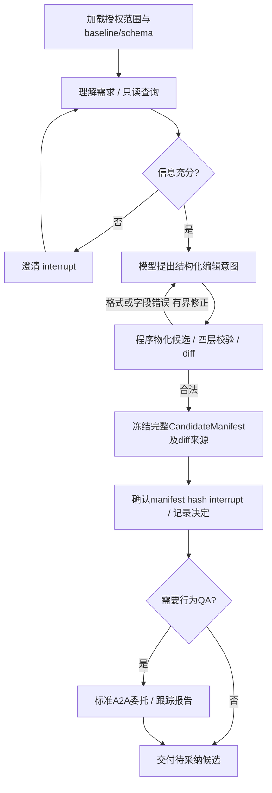
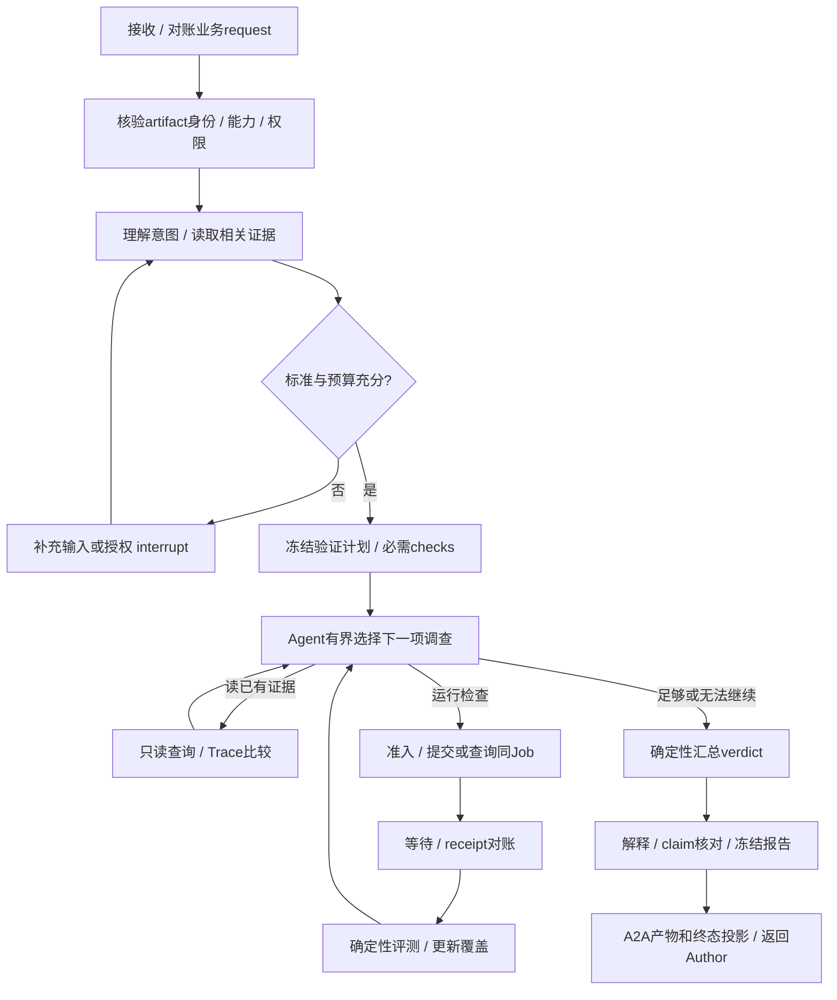
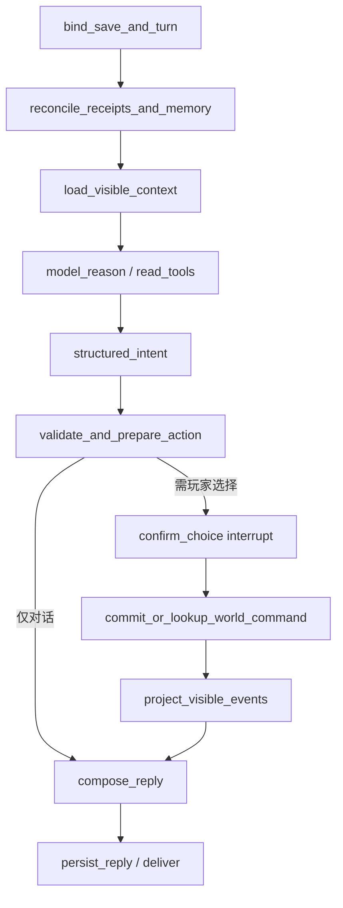

# 四能力编排、A2A边界与恢复协议

日期：2026-10-05。当前设计按Coding/Config/Verification/NPC划分；本文件替代旧Verifier生成候选/自行优化的图。与[总体方案](TECHNICAL_PROPOSAL.md)、[实施路线](IMPLEMENTATION_ROADMAP.md)共同构成实现基线。第7、8节明确保留历史已实现子集；目标图、协议与生产保障不因写入本文件而算已交付。

## 1. 选型、Agent与普通程序的分工

**本机 V1 执行子集：** 一个本地 QA driver，SQLite 保存确认、请求和 Job receipt，独立 SQLite checkpoint 保存图位置；MCP 子进程调用固定可信游戏解释器。receipt 先提交，图恢复后按同 request/manifest/参数取回；只有 running 而无 receipt 时返回待处理，不推测成功也不自动重跑。A2A completed 只代表已交报告。首版小样本仅 FAIL/INCONCLUSIVE，结构检查 PASS 独立展示。用户确认候选不等于采纳到游戏基线。

本轮不实现多节点 fence/lease、HA、OAuth、通用公网资源获取、生产级 outbox。下文涉及这些的内容是后续边界说明，不是 V1 阶段门槛。也不实现跨 revision 自动优化或共享 battle grant；每次显式批准的独立请求上限 2–12 场，图恢复不能重置它，模型演示共用持久总调用 cap。若后续新增自动修订链，再实现整条修订链的总 grant，不能把当前请求预算描述为已有跨 revision 总账。

| 能力 | 推荐组合与Agent判断 | Workflow边界 | 确定性实现 |
|---|---|---|---|
| Config | LangGraph自定义图＋LangChain模型、工具、结构输出；理解需求、选取相关schema/规则、提出配置 | 澄清、预检反馈、候选确认、可选QA委托、返回作者修订 | 版本/类型/引用/范围校验、物化候选、diff、内容hash、权限 |
| Verification | LangGraph有界工具决策；理解变更意图、规划检查、调查失败、选择补证 | 输入/预算批准、Job等待、receipt对账、报告交付 | 冻结输入核验、模拟/测试/统计、覆盖判定、确定性verdict、证据绑定 |
| Coding | Codex Runtime/App Server＋官方Python SDK；原生主循环和动态0..N子任务、Review | Adapter映射产品任务、审批、候选冻结、A2A委托与交付 | 工作区、运行权限、总预算、事件投影、真实测试/Review完成核验 |
| NPC | LangGraph＋LangChain；角色表达、可见事实检索、合法意图选择 | 确认、世界提交/对账、记忆投影、回复持久化 | 知情scope、资格/数值/世界事务、来源记忆、收据幂等 |

Agent是会根据目标和反馈选择下一步的模型驱动决策主体；Workflow是限定控制路径，Tool是可调用程序。一个LangGraph可包含模型判断和很多普通节点，不因此成为多Agent。A2A负责独立Agent的任务委托，MCP负责Agent到工具；不能将QA自主循环包装成一个大工具。FastAPI提供API，Pydantic负责业务schema，二者不替代Agent框架。

复用官方库：A2A1.2.1默认V2 request handler、executor/TaskUpdater、标准routes、TaskStore及client；MCP2.3.0 server/client；LangGraph1.2.12持久化与interrupt；Codex原生Runtime。参考固定tag内示例而非自写协议，[官方版本与源码审计](research/evidence/a2a-mcp-langgraph-audit-20261005.md)列出可复用接口与未验行为。A2A TaskStore持久化不等于恢复运行中的executor，MCP没有帮我们管理游戏Job或预算，图checkpoint不证明外部事实。

Config/Verification首版各一个自主Agent，按业务决定工具和下一步；不预设专业Reviewer。确定性claims核对可不调用模型。NPC的只读ToolNode与世界写节点分开。Coding动态委派是产品要求，固定1＋3只是[历史实验](research/evidence/collaboration-evaluation-20261004.md)；不再按该实验阴性推迟原生动态能力。全部成品模型调用走受审计DeepSeek路由，包含辅助/格式修复/子任务；没有静默provider fallback。

## 2. 状态所有权与模块边界

| 所有者 | 权威数据 | 不负责什么 |
|---|---|---|
| Author业务库（Config/Coding分别记录） | 原始需求、author run/revision、候选草稿/冻结manifest、策划确认、委托outbox、返回报告引用、采纳/发布决定 | 不能改Verifier报告，也不凭A2A completed当行为PASS |
| Artifact registry | 不可变baseline/candidate/build/evidence/report、byte hash、来源、大小/类型/ACL、引用保留策略 | 相同内容hash不授予跨用户读取权，路径/URL不自证可读 |
| Verification领域库 | 输入身份、验证目标/计划、check集合、授权grant、跨revision预算、业务request去重、operation/receipt、最终verdict | 不创建或修订Candidate，不存世界状态 |
| A2A TaskStore与协议投影 | 任务所有者、Task状态、message/artifact通信记录、与verification run映射 | 不代替业务预算/Job ledger/graph driver；SDK数据库≠跨服务事务 |
| LangGraph checkpointer | 节点/路由、待恢复interrupt、短消息与引用；每业务run独立thread | 不充当候选、预算、Job或世界权威，不回滚副作用 |
| Job Broker/Worker | operation ID、attempt/fence、lease、冻结环境、进程、产物manifest、完成/清理receipt | 模型/图取消不等于Worker已经退出；物理重算不冒充新统计样本 |
| NPC领域库 | 对话turn/intent/action引用、来源记忆、reply、inbox消费 | 不把研发聊天当角色经历，不直接改世界 |
| Game Host | 世界state/revision/RNG/资格、command receipt与outbox同事务 | 不从旧图checkpoint回写世界，不让模型决定奖励数值 |

建议新模块（设计，尚非现成目录）：`config/`管理作者；`coding/`管理SDK Adapter；`verification/`管理独立QA；`integrations/a2a/`放同一client与Verifier server adapter；`tools/mcp_server.py`做工具协议；`domain/artifacts.py`、`domain/jobs.py`、`domain/budgets.py`放领域保障；`game_adapters/combat.py`映射具体规则；`npc/`独立。接口通过版本化schema依赖，禁止共享可写的Agent会话对象。只有候选/证据等明确共享领域服务，不建设通用Agent调度平台。

GraphState只保存业务ID/hash、授权/证据引用、有界observation与路由缓存。Reducer按稳定ID合并引用，不盲目累加重复消息；大trace在artifact。预算/Job状态可缓存用于显示，每次准入必须读权威账本。模型消息裁剪保留tool call/result配对与来源，短期state不等于长期记忆。

首版单Supervisor、每thread串行队列；A2A各任务可并行，但指向同一业务run的重复投递只能激活一个driver。SQLite用于本机持久化，领域、协议、图三库不假设共同事务，靠outbox和可重入投影衔接。多实例需要另验所有权、checkpoint写保护与队列；简单lease超时不是旧driver死亡证明。

服务生成graph_thread_id，映射到业务run版本；禁止客户端直接选择他人的thread。图/state schema、prompt/tools、模型、policy、依赖与执行环境均锁版本。升级先完成旧图或显式迁移，不让新图静默读取旧checkpoint。[官方持久化](https://docs.langchain.com/oss/python/langgraph/persistence)

## 3. Author与Verifier各自的图

### 3.1 Config图：生成、检查、确认候选

“合法”只说明schema/类型/引用/规则和编辑权限通过，不等于行为目标达成。确认绑定已冻结完整manifest hash（包含baseline/candidate/scenario、规则/schema版本与diff来源），不是仅绑定candidate bytes。任何组成部分变化都产生新manifest和新确认，不复用旧批准。FAIL报告可使Author解释修订方向，但默认终点仍是把证据交给策划；需新修改时，作者根据明确新指令生成新revision，不能无限自优化。配置真正应用/发布另有操作，确认候选不直接改运行中的游戏release。

ConfigState建议：`author_run_id, baseline_ref, request_ref, schema_version, context_refs, draft_ref, validation_ref, diff_ref, candidate_ref, confirmation_ref, verification_request_ref, report_ref`。模型决定按`run+decision_slot`保存；恢复读已有决定，不因重复执行节点多生成候选、重复调用或重复确认。模型在保存决定前崩溃可能再次调用，费用如实记录。

### 3.2 Verification图：独立调查冻结候选

Verifier没有`propose_candidate/apply_changes/human_adopt/publish_game`节点或工具。它可以建议修复方向，但建议是报告文字，执行权仍在Author。固定代码/config/build身份贯穿所有节点；追加诊断不得替换输入。根据中间结果选失败seed、相关trace或更具体的测试体现Agent价值；只按脚本顺序调用工具的probe仅验证workflow，不能称已实现自主QA。

VerificationState建议：`verification_run_id, request_ref/hash, input_manifest_ref, intent_ref, clarification_refs, plan_ref/version, authorization_ref, decision_slot, operation_refs, observations, coverage_ref, report_ref, pending_interrupt_id, error_ref`。模型提出计划和check选择，程序核对允许工具、必需检查、授权和资源。模型不能删掉失败项/必要用例或用新的候选覆盖报告。

每项check保存PASS/FAIL/INCONCLUSIVE与事实。总体PASS必须所有必需检查完整通过；确定违反必需标准则FAIL并列明未完成覆盖；已接收任务缺少可判标准、必要检查暂不可用、样本或证据不足则INCONCLUSIVE。准入前不支持kind/profile或非法引用拒绝（REJECTED或标准输入错误），不包装为已完成调查。仅配对描述性实验保留观察量，行为总体不得偷换成概率保证。结构检查PASS与行为结论分开。基础设施故障可有不完整报告；若成功交付其限制，A2A completed＋INCONCLUSIVE，若服务无法正常交付才failed。

### 3.3 旧代码迁移准则

旧models/policy拆为编辑政策、验证计划、执行授权；Config拥有`apply_changes`及候选生成。四层validate可被双方调用；evaluator/report仍是确定性适配器，保持正确共同胜利配对定义与明确profile。旧tools拆只读查询、Author编辑、Job控制、证据读取；Verifier的allowlist无编辑工具。旧Loop/provider仅保留历史对照，不在一个图节点里整段调用。旧Reviewer可作为可选解释能力，claim核对始终由程序完成。

当前numeric worker要改成读取上游冻结全量输入，校验预期candidate/baseline/scenario及执行环境hash，不能只在输出中自报hash。失败也持久化诊断receipt并关联Author；报告成功与否都可回查。新任务/revision必须关联同campaign授权总账，不重置预算。具体源码缺口见[职责审计](research/evidence/verification-boundary-audit-20261005.md)。

## 4. 外部实验：提交完成但checkpoint滞后的协议

以“读取Author冻结倍率候选→运行获批的固定seed配对实验”为例，准入单位是一个逻辑experiment，可拆固定seed区间shard；预算按授权局数预留，重试物理CPU成本另计，不能无限免费重试。

1. 输入API先持久化已认证scope、业务request ID、不可变输入hash和verification run。Verifier模型计划/调查决定按稳定decision_slot入领域库；未保存的模型调用可再次发生并产生费用，但不得创建第二个逻辑check。以唯一键取已保存决定，重复计算的不同决定不覆盖原件并保留审计。候选是Author给定的只读引用，Verifier不生成候选动作。
2. `admit_experiment`以`verification_run + check_slot + shard_slot`唯一键事务get-or-create operation、预留预算、生成dispatch outbox；`candidate_hash/profile_hash/seed_manifest_hash`是该记录的冻结payload，不能塞进唯一键把同槽不同检查参数变成新操作。相同槽不同payload报冲突。首次ID由此持久映射创建，不能在执行节点重跑时临时生成新UUID。新revision可建新图thread，但继续关联同一任务授权总预算；扩大额度必须有新授权记录。
3. Dispatcher可多次投递；Broker按operation ID幂等接收。Worker采用attempt/lease/fencing token，只允许当前attempt提交终态。产物先写临时目录，校验后发布不可变manifest，再将hash写入完成receipt；原子rename不等于断电持久性，需flush/fsync和恢复扫描策略。跨文件与DB提交有间隙，因此只有完整且hash吻合的receipt能完成对账；残缺产物进入隔离/重建记录。
4. Worker完成、图尚未写新checkpoint就崩溃：恢复进入同一收集/执行节点，先按operation ID查领域receipt。已完成则校验输入/产物版本并绑定证据，**不重新扣预算、不重开实验**。报告/evaluator以experiment+policy版本唯一键生成，不重复发布。
5. Job仍运行则等待同一job；lease过期且无可验证receipt，纯模拟可用相同seed manifest重算同一逻辑shard，并记录新attempt和额外CPU。物理计算可能重复，逻辑账本只接受一个结果；不能声称恰好执行一次。未知的非幂等外部写入进入人工对账，不自动重放。

“不重扣预算”专指同一逻辑样本reservation不重复建账，绝不是重算免费。每次物理attempt启动前预扣其局数和CPU上限，崩溃已耗额度不返；恢复预留按实测执行成本在授权时冻结，只用于原manifest的基础设施恢复，并给每shard明确attempt上限。达到物理/CPU/disk任一上限停止并保留不完整结果，不追加样本或重试到统计PASS。旧120960/133056场仅保留为历史条件示例，当前没有该默认执行授权，详见路线8.3；模型重发同样独立核算真实token成本。

图检查点选择`durability="sync"`作为关键流程基线；它减少下一节点开始前的恢复窗口，仍不能消除第4步。官方 [checkpointers](https://docs.langchain.com/oss/python/langgraph/persistence) 描述图内持久化；账本、manifest和幂等键是本项目补齐的跨系统协议。

## 5. 重复恢复与审批

服务内部/可信UI的恢复请求带`request_id、expected_run_revision、checkpoint/interrupt_id、approval_id、payload_hash`，服务先鉴权/校验scope；业务DB唯一约束处理相同请求，参数不同拒绝，终态返回现有结果。仅当前待处理interrupt可收到`Command(resume={interrupt_id: value})`；失败节点续跑用同thread的无新输入恢复，不能把任意旧`Command(resume=True)`投给下一个审批。

审批接受、业务状态CAS和wake-up outbox同事务：如果服务在记下批准后、调图前崩溃，Supervisor仍能从pending wake-up恢复；图已前进而API响应丢失时，对账当前checkpoint/领域状态并将该wake-up标完成，不再投递到其他中断。恢复值只是通知，节点读取权威approval记录并核验提议hash/revision，不能直接把resume payload当授权。不可只用内存“已消费”标记，也不可先永久消费再假定图一定收到。撤销和超时提revision，旧批准无效。

首版一个Supervisor独占图驱动，每thread串行。恢复前确认旧driver已退出；数据库lease超时本身不证明进程已经停下。Worker fence只保护接收端已实现原子fence检查的领域写入，**不自动保护checkpointer免受旧driver覆盖**；多Supervisor必须额外实现checkpoint写入所有权协议，首版不引入这个复杂度。

interrupt恢复会从所在节点开头重新执行，故“创建审批/生成动作/扣预算”不放在interrupt之前做无幂等写入。interrupt节点只读冻结材料并验证恢复值；不吞掉框架中断异常，不改变同一待恢复节点内interrupt顺序。参见 [官方interrupt语义](https://docs.langchain.com/oss/python/langgraph/interrupts)。重试仅用于有界暂时故障；schema/越权/统计未通过走业务分支，不重试到成功。取消停止新准入并对账已提交作业/行动，不回滚世界、不恢复消耗预算。

模型provider重试、节点RetryPolicy、格式修复三层合并核算上限；`max_attempts`含首次调用，不能三层各3次却宣称总计3次。`recursion_limit`只限制图步数，不替代跨resume的token/实验/CPU预算。框架drain/timeout不负责杀外部进程，仍须Broker确认回收。

## 6. NPC：组件组合与真实玩家流程

LangChain具体用法：锁provider的ChatModel执行`invoke/astream`，记录usage；`bind_tools`配`@tool`声明只读事实/记忆查询的schema，以`ToolNode`生成匹配tool_call_id的observation；工具读取服务端注入的scope，玩家/model不能传入任意save_id。结构输出节点用`with_structured_output(NPCIntent, method="function_calling", include_raw=True)`，保留原始响应和解析错误。`NPCIntent`包含话语草稿、来源ID、有限行动类型、预编写内容ID、是否需要玩家选择；extra字段、未知ID、超限参数由Pydantic及领域校验拒绝。每轮只读循环最多2轮/固定token预算，最多一个世界写动作。

模型输出的“需要选择”只能作建议；服务端action policy决定是否必须确认，路由和commit都校验持久玩家决定，合法JSON不能绕过确认节点。API入口按`scope+client_request_id`事务get-or-create对话turn/thread，初次POST响应丢失也只产生一个turn；同ID不同输入拒绝。除每thread串行外，首版对同`save_id+npc_id`对话排队，conversation revision约束回复顺序；跨NPC并行世界写入仍由Game Host revision/资格事务决定。

模型provider的“支持结构输出”要实测当前model；schema验证不等于授权，更不等于世界事实真实。本次锁的DeepSeek适配源码会把`json_schema`映射到`function_calling`，因此不声称使用provider原生strict JSON Schema。先用上述显式方式验收；原生能力后续单独锁定。无效输出最多一次修复，再降级，无限格式重试会破坏延迟和费用预算。[模型接口](https://docs.langchain.com/oss/python/langchain/models)、[结构输出](https://docs.langchain.com/oss/python/langchain/structured-output)、[DeepSeek组件](https://docs.langchain.com/oss/python/integrations/chat/deepseek)。

例如玩家向岚请求护盾：角色依据已知失败经历提出`shield_start`；程序检查支援资格和内容版本；玩家点选；Game Host事务消费资格、记录支援状态、command receipt和可见outbox；NPC收到成功事实后才说“已为你准备好护盾”。提交前只能说“可以为你准备”。模型不控制倍率/期限，不把工具调用文本当成功证明。

GraphState只存`scope_ref、conversation_turn_id、world_revision_read、visible_context_ref、bounded_messages、intent_ref、action_id、approval_id、world_receipt_ref、reply_ref`。生成意图先在NPC领域DB按`turn_id+action_slot`冻结，action ID持久化后才发Game Host。对话文字本身也有稳定reply/message ID与投递outbox；UI重连upsert消息，不把同一次成功回复显示两遍。

### 行动已执行，响应丢失

Game Host先鉴权scope，再按`save_id+action_id`查receipt，**对已知相同payload先返回原收据，再考虑新命令expected_revision**，因为成功提交已推进revision。相同ID不同参数拒绝；未知ID才检查当前revision、角色scope、玩家选择、前置条件，原子写世界+receipt+outbox。另以`save_id+出战/任务实例+资格或奖励类型`设领域唯一约束，防两个不同action ID重复消费同一资格/领取同一奖励。NPC超时后查同action ID或重发同命令，不再向模型请求新动作、不新生成ID。不能确定结果就显示确认中，禁用重复选择，后台对账。

NPC若在世界提交后、记忆写入前崩溃，inbox按`save_id+event_id`去重，同事务写可见来源记忆与消费游标；投影乱序先补齐缺口，不以先来的较大seq吞掉较小事件。世界事件只向有知情资格的角色投影，不能让outbox变成全知通道。派生摘要失败不阻止权威receipt回读，可后台重建；下一轮相关上下文先对账。

首版NPC服务单次消费事务写入该事件全部有知情资格的角色投影，各投影再以`save_id+npc_id+event_id`唯一，全部写完才确认inbox。若后续改为按NPC分别投递，inbox键也必须加入npc_id，避免第一个角色消费后把其他合法角色的同事件丢掉；角色间不共享未授权内容。

若迟到时已切新存档分支，原命令只属于原save/lineage；新分支不接收旧响应。原分支已经发生的动作仍如实保留，不因图取消或分支切换删账。恢复图需要世界的新事实时重新加载，不把旧checkpoint里的世界投影写回游戏。

## 7. 2026-10-04框架实测与后续硬验收

本轮真实安装并锁定：LangGraph1.2.12、checkpoint4.2.0、SQLite saver3.1.1、LangChain1.4.3、core1.6.6、DeepSeek组件1.1.1；Python3.11.9研究环境独立于旧项目。依赖见 [锁文件](research/probes/framework-requirements.lock.txt)，当前先以已测3.11.9推进，升级Python3.12仍需G0验证，以上不是长期默认最新版。

[离线探针](research/probes/langgraph_recovery_probe.py) 与 [实际结果](research/evidence/langgraph-20261004-mtqwchsr/result.json)：

- 实验fixture、NPC fixture分别在领域事务提交后`os._exit(73)`；checkpoint仍停在effect且没有receipt。新进程分别续跑3次，实验只有1笔12局预算预留，NPC只有1份奖励/1条outbox；回放旧checkpoint也未增加副作用。
- 真实`interrupt`一次暂停/恢复使同一节点进入2次，验证恢复边界。
- 真实ChatDeepSeek结构化调用经`httpx.MockTransport`离线响应，Pydantic解析、`@tool`与编译图内ToolNode配合通过；首次直接调用ToolNode缺少Runtime失败，检查已安装源码后改为图内执行，原失败记录不抹去。

探针不是完整产品：未跑真实provider、游戏模拟或Unity；未验收并发resume CAS、fence、inbox乱序、断电持久性、生产异步saver和升级迁移。使用真实框架≠这些领域保障由框架自动提供。后续M3/M4须在真实服务重复上述故障并覆盖这些缺口。

最终验收新增：旧Loop不再被运行图包裹调用；导出Config/Verification/NPC三张实际图和节点轨迹；逐步解释superstep/reducer/checkpoint；展示失败并行节点的pending writes语义；演示错误retry与interrupt区别、重复恢复无重扣/重奖、checkpoint与领域账本冲突对账、版本升级处理；提供真实模型组件smoke、带分母的任务评测和框架收益/成本对照。Coding则用Codex原理链路讲解，保持其独立运行时。

## 8. 2026-10-04已实现子集与真实恢复证据

[src/agent_workbench/verification](src/agent_workbench/verification/workflow.py)是独立本地实验服务：`validate → authorize interrupt → experiment`；实验节点在领域层准入、调用可信numeric worker、接收结果收据。它不调用旧while-loop，也没有包装假模型冒充Agent。完整需求理解、QA调查决策、异步等待和UI尚未实现；其中候选生成在新设计迁往Config。

图仅含request ID、批准路由缓存、receipt hash；原始需求/冻结计划/批准/物理局数及结果保存在独立领域库。批准按plan hash绑定，resume只是唤醒；领域已批准但尚未唤醒，可再resume。OS文件锁保证一个目录单driver，进程退出释放，不依据短lease猜旧driver已经死掉。审批不可修改；需要新计划时创建新request，但当前只提供每计划cap，尚无生产级跨revision任务总预算，不能给模型无限创建计划的入口。

worker复用原四层候选校验与simulate，仍内部apply_changes构造候选，输出候选/场景hash并绑定源码指纹和plan hash；现Store未核对上游预期candidate hash，因此不能当新只读候选服务验收。不在模型服务里加载候选代码。它是可信配置执行，不是不可信代码隔离。所有固定pair齐全才接受receipt，AV使用Fraction配对；报告只给DESCRIPTIVE_ONLY。SQLite中摘要与hash在同一完成事务提交，尚无大文件manifest/outbox；这些完整生产机制不能冒称已交付。

[最终故障实验](research/evidence/verification-recovery-n7zc67l5/result.json)：真实4场完成后，领域commit而experiment节点尚未返回，进程以73退出；图checkpoint仍待experiment，三个新进程resume仍同一收据、扣账4场。另在准入后、worker执行前以74退出，账本保留4场保守扣账但实际模拟0场，恢复明确拒绝自动重跑。无receipt不等于没执行，首切片选择保守停下；正式异步job再引入同job有界重算和attempt账本。

[16项测试](tests/test_verification.py)覆盖批准/拒绝、错hash、payload冲突、错候选收据、缺失/重复结果、整数配置、实际导入入口指纹及双进程锁互斥。独立评审发现并修正了收据未绑定plan、整数转float和源指纹遗漏包入口三处缺陷，失败复现后再验收。早期研究结果保留，不作为最终代码hash证据。

这些结果扩大了第7节原fixture结论，但没有完成并发HTTP审批、生产异步saver、job取消/超时进程树回收、外部文件损坏恢复、NPC真实世界和模型质量验收。完整阶段验收仍按路线执行。

## 9. A2A任务、MCP作业与跨服务恢复

### 9.1 标准接入与数据最小化

一张Verification Card，一项`verify_candidate` skill；支持的输入kind/profile如实声明。Config/Coding复用同一官方client封装、业务schema和返回解析，不建设两套协议。使用标准A2A1.0 JSONRPC请求、Task/Message/Part/Artifact和SSE；业务manifest放结构化Part，协议适配器把Task映射到verification run。当前没有旧A2A客户端，不启用0.3兼容或gRPC。[规范v1.0.1](https://a2a-protocol.org/v1.0.1/specification/)

Author发送业务request ID、baseline/candidate manifest refs/hash、意图/必需检查、有限摘要和grant引用。原始日志/代码按允许的artifact工具读取，不能在Agent Card或消息里塞整个仓库。候选配置复用固定模拟代码；code基于Git worktree/冻结patch，build基于内容地址产物。P4只是可映射身份的未来接口，当前不宣称已接。

服务认证生成principal/project/权限上下文；body中的author只作声明且必须匹配可信上下文。请求、补输入、Get/List/Subscribe/Cancel和artifact读取均需范围核验；contextId不是租户隔离。第一版限制loopback且校验实例凭据，远程上线另验TLS/OAuth等正式身份。测试header只能当本地fixture，不算生产认证。调用A2A不转交模型密钥，MCP服务使用自己的受控权限，不透传任意caller token。

### 9.2 三层ID、去重与丢响应

Author在发送前事务写`verification_request_id + immutable_input_hash + submission_outbox`。服务按`authenticated_project/author + verification_request_id`唯一键准入；同payload返回同业务run/报告，异payload冲突。JSONRPC id、messageId、taskId不是业务幂等保证。重发可能产生另一个A2A Task投影，但不能再运行一份领域检查或扣第二份逻辑预算；所有投影最终关联原run。这里使用A2A标准数据承载领域去重键，不私造替代协议。

1. 提交响应丢失、Author没有taskId：重投同业务ID/冻结payload，通过官方SendMessage找回业务结果关联；服务先去重再准入。不能临时换requestId重新计费。
2. 服务已接收但还没启动图：领域准入与待调度outbox同事务，Supervisor启动扫描补调度；SDK TaskStore本身不负责复活工作。
3. Worker已完成而checkpoint旧：沿第4节按同operation查receipt，补observation/报告，图和Task投影可重复刷新，不重跑领域效果。
4. 图已完成而A2A artifact/terminal未发送：报告先持久化并写projection outbox，再更新SDK TaskStore/发流。投影重复按report/artifact版本幂等；Get读取最终产物。不能先completed再假定报告会成功写入。
5. SSE丢包/客户端重连：活动任务Subscribe首读当前Task，再看新更新；终态用Get读报告，UI按自身持久event序号补齐。协议不保证任意历史delta全重放；stream断开不自动取消Job，也不创建新run。[任务生命周期](https://a2a-protocol.org/v1.0.1/topics/life-of-a-task/)

### 9.3 补输入、状态与取消

INPUT_REQUIRED只允许服务声明的当前问题/计划批准补充，绑定task/run、pending_input_id/代次和候选hash。补输入写独立不可变记录，再唤醒当前interrupt，不修改首次请求的冻结输入；额外验收要求需计划新版本和必要新授权。换候选必须由Author创建新candidate/request。AUTH_REQUIRED用于真正的带外认证，聊天里一句“批准”不能顶替可信授权。终态任务不重新打开，后续验证建新任务但延续campaign总预算。

A2A completed表示服务已交付一个合法报告，不是候选PASS；FAIL/INCONCLUSIVE可正常completed。rejected表示未接受范围/权限，不证明候选质量；failed保留运行错误而非伪造业务FAIL。报告必须把停止原因、覆盖和已知失败列清。预算耗尽可结束为INCONCLUSIVE；已经发现确定必需标准失败则FAIL并说明其余未测。

CancelTask是尽力取消。领域层先持久化停止新准入，再向运行Job发取消，记录取消请求/模型turn终止/Worker物理退出/证据保留四种事实。返回协议canceled不保证任意远端进程已死；产品继续显示清理中直到Broker回执。若报告已提交则返回其终态/不可取消，不删证据或回滚预算。客户端本地asyncio取消、SDK close、MCP断连同样不等于远端Task/进程回收。

### 9.4 MCP工具与副作用边界

短工具：查询schema/config、校验冻结配置、读指定artifact/trace、比较已记录事件。长工具：提交命名check profile、查询job/result、取消job；输入包含稳定operation引用和冻结manifest，执行许可来自服务端scope/grant。底层复用同一GamePort/Job服务；MCP JSONRPC ID只负责本次调用关联，不作为job幂等键。MCP2.3无Tasks实现，不能把未实现扩展列成交付能力。[SDK迁移事实](https://github.com/modelcontextprotocol/python-sdk/blob/v2.3.0/docs/migration.md)

Verifier仅写自己的证据区，候选只读挂载或由artifact服务提供；控制面测试清单和Oracle不来自可改候选。代码/build在受限worker，独立无模型凭据，工具profile固定cwd/argv/env/超时/输出。文件引用同时校验ACL与resolve后的根目录，拒绝路径穿越/符号链接越界；外部artifact URL需限制协议/host/重定向/大小，不能靠一个SHA防止SSRF。只读工具也有数据外发风险：发模型的内容受项目数据范围与授权限制。

### 9.5 恢复验收矩阵

| 故障 | 必须断言 |
|---|---|
| 两Author同Card访问／伪造author／跨owner Get或Cancel | 同一能力；可信身份决定权限；无跨项目结果泄漏 |
| 发送丢响应／同ID重发／同ID换候选 | 一份业务run与预算reservation；参数冲突拒绝；允许不同协议Task关联原run |
| INPUT_REQUIRED重复、旧问题或终态补输入 | 仅当前待输入生效；候选不变，旧输入不能批准下一阶段 |
| Job先完成／图checkpoint未更新／多次resume | 校验同输入receipt；不重扣逻辑样本；实际attempt另计 |
| 报告已提交／Task投影未更新／流丢失 | 重建同report artifact，Get可回查；不重新验证 |
| 取消与完成竞争／MCP或SDK连接断开 | 不丢已提交结果；未知作业明确标注，清理以物理receipt为准 |
| 篡改候选/trace／候选代码试改oracle或越界 | 准入或证据核验失败；不得PASS；候选/控制面只读边界有效 |
| Config修订新版本／再次委托 | 原候选/报告可追溯，新request延续总grant；无自动无限调参 |

当前的本地协议和领域探针只覆盖上述部分边界，具体结果以[验证报告](VALIDATION_REPORT.md)本轮记录为准。正式服务还需跨进程故障、真实身份、完整MCP/游戏、DeepSeek动态QA和Unity验证，不以fixture通过清空此矩阵。
