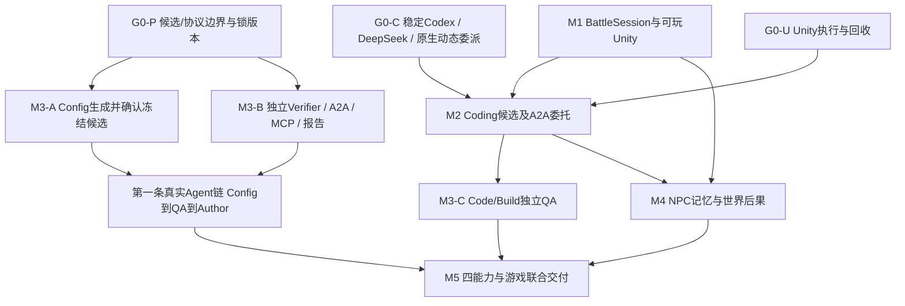

# 分阶段实施、验证与交付路线

> **2026-10-27连续交付顺序：** 工程与审查修复已完成 → 一次具体授权 → 真实思考工具协议冒烟 → 三项研发任务 → 必要时在固定两槽中修订候选 → 全部核心交付完成后运行两项有/无资料核查 → 语义与程序证据分别复核、页面审阅、统一关闭预算。总批106次/USD5.10尚未授权，0新增模型调用；未知用量或不确定验收停止后续收费阶段，不靠追加额度或改评分完成任务。工程418项/前端34项/构建通过。

> **2026-10-27后续：** 上下文与收尾修复已通过本地回放/真实Docker/405项工程回归；授权的同三题真实开发回归仍只有资源修复完成，上限实现与护盾结论未完成。先分析如何让调查形成实施与正常交付，再安排确需规则资料的RAG对照；不把工程测试、partial正确拦截或同题回归当模型任务质量提升，也不自动追加费用。

> **2026-10-27当前增量：** 研发资料导入/确认/冻结检索、图/页面集成与本地小样本检索评测已实现；保留词法同义漏召回。先完成新LangGraph三题真实模型基线（材料已封存、已获具体授权），逐题复核候选检查与最终解释，再选择确实依赖规则资料的任务做有/无知识对照。当前8项业务清单中5项是待人工证据核查，不冒称8题自动修复基准。不新增LlamaIndex、Embedding、多Agent、NPC或企业级设施，也不自动推送。

> **2026-10-25当前路线优先：** 模型/工具适配与图主链路→上下文/恢复→项目记忆/页面→本地业务验收。具体执行与已验证状态见[本轮计划](docs/superpowers/plans/2026-10-25-graytower-framework.md)、[开发记录](开发记录.md)和[当前上下文](current_context.md)。旧多Agent/A2A/NPC里程碑为历史，不再强制建设；新框架真实模型验收需新的具体材料与费用确认。

## 2026-10-08 实施进度（最新）

**本轮交付结论（优先于下方早期进度）：** P2正式代码Task/CodingService、P3独立代码QA、P4本地采纳/回退/重新测试已落到真实页面。Config→QA→配置试玩和护盾修复→独立QA→源码版本采纳两条链路可演示，普通入口18784默认关闭模型。战技点第二题真实模型修复首次QA失败，拦截采纳并保留证据；按用户要求不再追加收费修订，交由亲测后决定。中文手册和直接体验入口已完成。下一阶段按真实使用反馈修正问题，再考虑授权修订、更多独立任务与协作质量评估；不先增加生产级设施。代码版本采纳暂不自动发布到Unity，NPC保留既有离线剧情演示。

**P2 后续实际进展：** 用户授权 scope d054c1a5...d0d72 后，真实 Codex Runtime/DeepSeek 已定位并修复 D-01 护盾扣血故障，只有 effects.py 一处表达式变化；原始故障 2FAIL/2PASS，候选4PASS；重复读取同一收据不新执行，原生 Review 绑定冻结文件。7调用/0未知，峰价估USD0.013317168，未用11次关闭。`/code-repair` 提供只读实际补丁/测试/Review/费用页面。50项Coding＋4项代码领域定向回归，以及single/auto真实Runtime脚本夹具和旧numeric Runtime夹具通过；夹具不是模型质量成绩。证据见 `research/evidence/python-coding-d01-20261008.json`。P2/P3继续完成正式代码任务的准入/恢复/统一Task与独立QA接入，随后D-02与P4；尚未宣布完整计划完成。

用户批准《计划文档.md》后，P0/P1 已交付统一任务中心、冻结 JSON/Excel、批准测试、独立 QA 和真实时间线。C-01 合法修改、C-02 越界拒绝、C-03 歧义澄清已完成真实 DeepSeek 演示：7 次调用、4 场战斗、0 未知调用，峰价估 USD0.007370832；余下 3 次额度关闭。入口 `打开任务中心.cmd` / http://127.0.0.1:18783/tasks ，默认关闭新模型调用。QA 结构 PASS、样本总体 INCONCLUSIVE，不宣称总体平衡改善。

P2 最初先做工程预验证：固定游戏 Commit 的真实 Git worktree、冻结补丁重建、Docker 非 root/无网络/只读执行；受控护盾故障失败，人工参考修复 4 项通过，重复读取同一 Job receipt。这一步不计为 Agent 成绩；随后的真实修复见本节首段。下一步把代码任务接入统一 Task 与独立 Verification，再做 D-02 和 P4 本地采纳/回退。容器异常清理、恶意候选/资源负例须在扩大执行范围前补齐，暂不开放任意代码。最初预验证证据见 `research/evidence/task-center-p1-20261008.json`；实施裁决见 `research/evidence/task-center-p1-rulings.md`。

> 2026-10-05最新推进口径：用户要求优先尽快完成可演示闭环。当前营地/战斗/战报/记忆离线演示已实跑，见[中文使用手册](使用手册.md)。本轮不以全量故障矩阵、Electron或大型新评测阻塞演示交付；原长期门槛保留为后续工作，未测不算通过。NPC真实模型未运行。

**2026-10-05 M1 最新验收：** 用户已在真实 Unity 中完成破盾战技及丢响应重试：相同请求提交两次，仅结算一次，revision 1、1 条命令、11 个事件，完整组件状态与权威快照一致。已确认态 Player 重启和正式启动器均读回同一存档、无新行动。但原生 Alt+F4 退出两次触发 UnityPlayer.dll 访问冲突；一次独立恢复探针在读回后超时回收。正常退出、pending 跨 Player 重启及完整自动战斗输入未通过，M1/G0-U 不关闭。详见[现场证据](research/evidence/m1-player-interaction-20261005.md)。

**2026-10-05 最新进度：** G0-C已完成正式SDK/CLI0.160.0真实single/auto文件修改→原生Review→固定auto候选同QA（20调用/4场，批次关闭），Coding页面已接两条真实运行与原报告；自主spawn0，Review子线程2，效果仍不能外推。下步从新D:/Desktop/graytower-game副本推进M1 BattleSession与Game Host，同时验实际Unity许可/UTF。M2代码/build、动态协作质量、取消/恢复和完整Unity/NPC尚未退出。[记录](research/evidence/coding-live-workbench-20261005.md)。

更新：2026-10-05。执行[总体方案](TECHNICAL_PROPOSAL.md)的四能力边界及D01—D12。Coding动态原生子Agent保留；Config生成候选；Verification经同一标准A2A服务独立验证冻结候选；NPC独立。旧阶段编号沿用便于关联证据，不代表必须按数字顺序串行。研究探针与产品阶段分开验收。

## 1. 推荐推进顺序与当前交付范围

**用户已批准实施，V1 范围覆盖旧生产级门槛：** 单机、本地服务、SQLite；候选身份、幂等、Job receipt、基本崩溃恢复。OAuth/HA/公网 SSRF/分布式 lease-fencing/生产级 outbox 不进入 V1。G0 的 A2A 清理先官方最小案例与上游核验；本机短演示可在限定生命周期内推进，不先维护 SDK fork。

第一步交付一个 CLI 业务切片：策划自然语言提出击破手战技倍率修改→真实 Config 生成冻结候选及 Diff→操作者确认→标准 A2A 独立 QA 决定模拟/读 Trace→真实游戏证据与准确结论回 Author→重启重复委托复用报告。验收须包含真实 DeepSeek 调用、真实战斗、失败/未知收据处理；fixture 的工程测试单列。此次只验证一项可信数值字段，不代表完整 M3-A/B 独立需求评测或 UI 已完成。

后续各阶段演示顺序不变，但退出必须能实际操作：React 策划/QA 工作台沿同一服务；Coding 经受测 Runtime 生成候选并委托同一 QA；Unity 能真人行动并跑完整测试链；NPC 能交谈、选择支援并在战斗中看到规则一致的效果。增加架构文档或接口不能代替这些结果。

**续验进度：** 本轮独立Config开发首轮5/6，通用状态定义修复后的同6题回归6/6；不是确认集成绩。真实新候选QA已完成4场并返回报告，但非法策略首次尝试、部分Trace过度解释仍记失败，不能用后续工程修复声称已通过干净验收。下一小步以独立需求和明确证据引用验收修复后的QA，再接React；范围仍是本机V1。详见[续验与原始证据](research/evidence/v1-followup-20261005.md)。

**单决定与Config确认最新结果：** JSON严格适配落地，4次已知异常上下文回归通过；12题Config首次确认各1调用，独立助手24项标准复核12/12通过，真实1.48候选已在工作台展示。合计16调用、0新战斗、峰价估USD0.018343908，剩余额度关闭。不是完整M3或多Agent效果证明。下一步推进G0-C稳定Coding Runtime正式入口、同QA衔接与QA新版完整业务链验收；Unity/NPC继续按原退出门槛。见[本轮证据](research/evidence/json-decisions-config-confirmation-20261005.md)。

**工作台最新结果：** 页面已完成真实浏览器链路，两题共7次DeepSeek/8场、费用估USD0.00663312。独立助手复核语义完成，但两次双Decision返回使首次不算规范无故障；解析guard已离线修复，真实效果待新独立确认。候选确认、报告/Trace、页面刷新、零额度收尾和重放已验；M3完整退出仍未完成。见[工作台实测](research/evidence/workbench-qa-20261005.md)。

**工作台实施增量（任务定义）：** React 配置提案与独立 QA 页面接同源本地 API，复用现有 LangGraph/A2A/MCP/领域层。工程退出检查候选差异→确认→QA 目标/预算→持久进度→程序事实/错误/Trace，覆盖刷新、重复提交及中断恢复；实际浏览器操作使用独立目录中的真实历史证据，明确不算新模型质量成绩。新的两题 QA 业务验收已冻结，一题核对小样本表现，一题查证实际战技事件与因果证据边界；先封存 payload/预算，再在新授权内首次运行、全部保留并独立复核。两题只是必要窄验，M3 的完整独立质量评测、Config 确认集和四能力集成仍须另行完成。

**当前轮完成范围：**源码/资料/标准审计、必要独立本地协议与冻结候选验证、架构及路线。没有把四Agent产品、真实DeepSeek QA、动态完整Coding或Unity链路标为已交付，也不启动旧收费batch。

**下一阶段首个Agent里程碑：**策划提出一项配置需求→Config查询/生成/确定性校验→策划确认冻结diff→同一Verification服务制定并执行验证→报告与失败证据回Author。先用可信数值配置，复用现有游戏核心，不等待完整Player；第一版不引入自动数值搜索。该链路与M1可玩游戏、G0-C稳定Runtime接入/G0-U执行边界并行。Config和Verifier都能独立启动/使用后，再接Coding的代码/build候选，不把全部风险塞进第一次联调。

开始产品代码前，将当前工作台纳入Git并固定来源、依赖和目录；旧项目未提交内容保持只读。验证输入/输出schema、一次性授权与总预算先于模型自由调用；协议适配跟随真实用例，不先建任意游戏/Agent平台。时间以阶段退出条件与真实工具链测量为准，本轮新增Config/A2A后不继续沿用旧三产品人日估计作为承诺。

| 最近工作包 | 具体产物 | 完成证据 |
|---|---|---|
| P1冻结契约 | CandidateManifest/VerificationRequest/Report、artifact registry、Config预检与Verifier独立复检 | Config kind真实游戏通过；hash/权限/篡改负例；Verifier无编辑能力 |
| P2标准服务 | 一个A2A Card/skill、两client适配、真实身份、持久映射/去重/失败报告、MCP领域工具 | HTTP卡发现/消息/流/Get/补输入/取消；两个Author同服务；跨owner拒绝 |
| P3真实Agent | Config及Verifier各自LangGraph＋DeepSeek，明确工具决策与预算、CLI/API入口 | NL任务、合法候选、计划、调查失败、报告返回；零隐式改候选；真实provider记录 |
| P4可见产品 | 同一React Config/Verification页面，Electron复用、任务/证据联跳 | 创建/确认/委托/断线恢复/失败重提交可操作，非只有脚本 |

P1/P2可用本轮探针经验，但探针代码先经迁移与安全检查，不直接复制为生产服务。P3需冻结将外发的数据范围与费用cap，已有六评测包授权不自动扩成新项目全源码授权。

## 2. G0：先关闭会推翻方案的风险

**结果：一份可安装的工具链清单、一套协议回归和明确的可运行权限配置。** 不建设通用平台。

1. 选择SDK与CLI配对，固定下载来源、版本、hash、schema快照；参考树没有commit时先固定源码内容hash，实施时再选可追溯上游版本。当前官方稳定CLI0.160.0优先配对评估；历史0.159 alpha与参考SDK默认0.153.4不能混为“已兼容”。
2. 在独立测试环境复用Python SDK，最小补丁：server request从stdout reader派发到有界异步队列；显式handler；超时/未知请求拒绝；写stdin串行；断开关闭全部pending；将构造参数贯穿同步/异步API。新增/暴露人工审批模式，显式配置 `approvalPolicy=on-request`、`approvalsReviewer=user`，在thread start/resume与turn start均校验，不让恢复回到高层默认auto_review。保留上游生成类型、路由、版本协商和公开方法。
3. 用fake server定向测试两个并发审批、审批时取消、out-of-order响应、超时、重复回复、进程重启generation、未知方法、巨大/慢事件；再用真实App Server+本地fixture验证流式、工具call/result、usage、interrupt和resume。
4. Windows权限矩阵：任务内读写、工作区外写入、外部网络、子进程清理；分别跑pytest、纯C#测试、Unity batchmode。对Codex shell和MCP→Broker两个执行入口分别测试。Broker首选独立无凭据App Server的command/exec、显式sandboxPolicy与固定profile；源码WindowsRestrictedToken分支不支持stream/terminate，先验证buffered+硬超时及进程树回收。模型turn取消、停止新增job、在途job退出分别记录；有在途作业时显示清理中，不能报全部已停。MCP进程不自动继承shell沙箱；普通子进程不算隔离。只对这套被测配置作结论。
5. **G0-U独立门槛**：隔离测试工作区内确认实际runner身份可用的Unity许可、build support、Test Framework/UnityWebRequest模块、项目锁、真实EditMode/PlayMode与Player tests XML、产品Player构建/启动、OS输入和Game Host loopback，以及硬超时/整树回收。失败最多两轮定向修复、约2个工作日；生命周期仍不合格，再做一次≤1日的窄Windows runner/Rust执行实验或选择经验证的隔离工作环境。仍失败就保持G0-U blocked，不豁免最终链路，其他独立工作可继续。详见 [Unity交付合同](research/unity-automation-delivery-20261004.md)。
6. 模型兼容矩阵：文本流、标准函数工具、apply_patch、请求中断、usage、错误/限额、长上下文处理。成品全部调用DeepSeek，Coding和Review同样适用；不隐式回退到其他厂商。基础dynamic function往返和inline Review已实测。旧CLI原生MCP/subagent发送namespace；V1受限子Agent窄映射已有真模型证据，原生MCP及完整工具仍未验；先测试锁定稳定Runtime的原生MCP与DeepSeek；若namespace仍不兼容，沿2026-10-04已测设计采用SDK dynamicTools→业务MCP client窄转接，并补MCP2及真模型契约。两条路径分别记录覆盖，不先造协议网关。每个case保存实际provider/model/版本；不跑昂贵效果集直到smoke通过。
7. **G0-F框架基线**：以本轮LangGraph1.2.12/LangChain1.4.3等研究锁作为候选，先使用已测Python3.11.9锁推进，在独立环境验证3.12后再迁移；核对异步SQLite saver、StateGraph、interrupt/RetryPolicy/流式API及真实provider工具/结构输出组合。复用本轮离线probe，再补并行pending writes、sync/async保存屏障、schema/图升级负例。输出版本矩阵、源码导览与数据库生命周期约定，不先建设通用编排平台。

### G0-P：标准协议与不可变候选门槛

锁A2A SDK1.2.1/spec1.0、MCP2.3.0、LangGraph1.2.12及完整依赖。复用官方handler/routes/store/client，不照搬0.3示例。核验同一Agent Card被Config/Coding发现，候选kind能力如实声明；标准Part承载业务manifest，不发整个仓库。旧MCP1.26研究桥单独保留，MCP2 API/httpx2迁移在新环境验证，长工具不依赖未实现Tasks扩展。

实现并测试：Author先冻结完整候选，Verifier只读；A2A taskId/业务run/graph thread/job各有映射；总grant跨修订延续；Get/Subscribe/补输入/Cancel/artifact按可信principal鉴权；同业务ID同payload只运行一次领域任务、异payload拒绝；task completed可携带FAIL/INCONCLUSIVE；报告先commit再投影。SQLite TaskStore可持久读回不等于运行中的Job自动恢复。

**新增已复现风险：**A2A1.2.1终态任务续输入被拒后留下两个EventQueueSource dispatcher和关闭告警；37项功能通过不等于生命周期合格。正式服务先核对上游修复或维护受测最小补丁，增加终态拒绝、断流、取消及重复调用后无队列/进程残留的回归；不通过不得完成G0-P产品验收。

**本轮研究退出：**本地真实协议fixture与真实游戏冻结输入分别有独立结果/失败边界；不声称两者已经联成真实Agent。**产品退出：**真实Config与Coding接入同一服务、game MCP工具、持久任务与跨进程故障、实际预算/身份、取消物理回收均满足M3验收；之后才把G0-P产品状态完成。

Broker配置核验：执行App Server的启动环境先剔除凭据，再限制shell继承；请求env仅是merge，不能单靠它实现白名单。每任务执行进程以对应worktree作为配置cwd，因为请求cwd不必等于sandbox基准cwd。Windows受限分支用默认输出cap，测试“连接断开但任务仍在运行”并保留资源所有权；不能把disconnect当清理成功。

执行服务有独立配置与数据目录，避免加载已有模型登录/插件；command/exec不会替Broker发起模型工具审批，profile授权与必要人工批准必须在发RPC前完成。

本轮G0-C进展：真实DeepSeek受限function往返与inline Review通过；原生MCP namespace问题已发现，官方MCP SDK窄转接仅离线通过。仍需DeepSeek端到端游戏工具、apply_patch/shell、审批、取消、恢复及CLI/SDK配对，不能凭本轮smoke宣布G0完成。所有model/Review/压缩/辅助配置走DeepSeek白名单，恢复旧thread也核对provider，未知隐式模型入口关闭。

**退出条件：** 无默认静默批准；审批等待不阻塞其他事件；可区分completed/failed/interrupted；CLI/SDK协议集、pytest受限执行与越界拒绝通过；G0-F框架版本/持久化通过；G0-U真实引擎/输入/隔离/回收全部通过。真实模型入口完成必要工具和结构输出smoke，fixture不计真实接入。子门槛分别记状态，G0-U未过不能把G0整体标完成，也不能完成M2完整引擎闭环或M5交付。

## 3. M1：第一个可交付阶段——真人可玩，同规则复现

**交付名称：灰塔前哨·单场战斗切片。** 这是进入正式实施后第一个面向用户验收的产品包。G0可以同时开展，不要求先完成全部Agent界面。

### 任务包及依赖

| 顺序 | 任务 | 可审查产物 | 依赖 |
|---|---|---|---|
| 1 | 锁现有规则、黄金trace与历史证据；建立新分支 | migration manifest、golden样本、原始指纹 | 无 |
| 2 | 从simulate提炼BattleSession，定义明确动作阶段 | create/observe/submit/advance/snapshot/restore；Bot改走同一路径 | 1 |
| 3 | 定义命令/观察/存档协议及兼容策略 | schema、版本、C#/TS消费样例、非法动作语义 | 2，可先并行草拟 |
| 4 | Python Game Host与玩家存档 | 本地HTTP、revision/幂等、事件分页、健康与退出协议 | 2、3 |
| 5 | Unity live输入与事件消费 | 技能/目标/终结技窗口、状态提示、重连/暂停、结算 | 3；先用契约fixture并行 |
| 6 | 启动与打包 | start-demo、doctor、Player+sidecar、说明 | 4、5 |
| 7 | 真机与一致性验收 | 命令日志、两路径hash、录屏、失败证据 | 6 |

快照只在定义好的决策边界保存；一期只支持同构建恢复，跨规则版本拒绝并说明原因，避免仓促实现迁移。可选终结技必须有“使用/跳过”的明确阶段行为，防止保存后重入触发两次普通行动。最终事件/快照提交与命令收据在同一事务或可恢复日志提交点内完成。

### 验收门槛

- 原181项回归保持通过（旧入口保留），新Bot路径对既定黄金样本的结果/规则事件一致；如合理语义修改导致不一致，必须单独列变更、提版本，不能直接刷新golden求通过。
- 至少20个场景覆盖普通动作、终结技前后、SP不足、DOT致死、蓄力打断、召唤、阶段切换、胜/负/超时和边界资源。
- 对每场景记录命令，再从headless重放；对选定5个关键决策点保存/恢复，终态、规则事件、随机序列一致。不得比较仅含展示字段的截图。
- 非法、重复、过期命令验证：无多扣SP、无多发奖励、无多推进RNG；断连后拉取的快照为权威状态。
- 真实构建Windows Player，操作者用按钮选择行动并完成至少一局；完整记录该局动作，再无头复现。同seed不同真人行动无需相同结果。
- 自动harness通过真实OS键鼠→Player UI/EventSystem→HTTP命令完成胜/负各一局，并覆盖断连、重复/迟到事件、存读档；回读对应revision的typed场景状态对照Game Host，重放实际已接受命令。不能直接调按钮方法或直接POST命令代替输入测试。真人试玩保留为体验补充。
- 当前补齐玩家键盘入口：↑↓在可交互控件间移动、Enter确认，提供明确焦点与中文提示。初次/终局聚焦新战斗，读回后聚焦合法行动，选择后聚焦执行，未知结果聚焦原命令重试；忙时不接受提交，控件重建恢复有效焦点。真实按键仍走 uGUI EventSystem/Button 与相同 Client 请求；组件测试和最终原生 OS 输入分别验收，不加入测试专用执行后门。
- 正常启动/关闭不遗留自管进程；sidecar崩溃时明确停止输入并支持恢复，不假装动作成功。
- 性能初始目标：本机不含动画的动作确认p95≤200ms，30次正常操作；冷启动/重连单独计时。若未达标先测分解，不以一次整场模拟时间代替输入延迟。
- 可交付zip不依赖Editor；离线战斗可完整运行。M1营地只保留故事入口或预写对话，不标注为NPC Agent完成。

**本阶段讲解：** 为什么只有一套规则；Bot与真人如何共享推进；seed与RNG状态的区别；trace、命令日志和存档分别解决什么问题；Unity状态回读能证明与不能证明什么。

## 4. M2：Coding Agent游戏研发闭环

**结果：在工作台提出真实跨Python/C#任务，交付可以审查的修改与有效验证回执。**

实现范围：仓库/任务选择、独立worktree、基线dirty快照策略；SDK补丁adapter；thread/turn/item与应用状态映射；流式UI/审批/取消/重连；MCP游戏工具（按稳定版实测，必要时保留dynamicTools窄转接）；快速规则与真实引擎测试profile；diff、结构化review、结果校验、usage与artifact导出。迁移旧React/Electron组件，但替换旧工具名硬编码与 `window.herta` 依赖为宿主bridge。

任务状态：`created → preparing → running ↔ awaiting_approval → validating → reviewing → ready_for_review`；异常为`failed / interrupted / cancelled / blocked`。这些是产品状态；原样保留上游turn status。`ready_for_review`要求patch基线正确、指定测试真实执行、review结构化完成；用户随后决定集成。

执行工具只接受命名profile及受限参数；每个profile定义运行环境、超时、产物和必要用例。测试清单/隐藏验收放控制面，模型不能通过改清单减少验收。所有候选代码在任务工作区受限进程执行；控制服务不加载候选Python模块或C#程序集。

**退出条件：** 3个代表任务闭环（已复现或标明注入的Python规则bug、Unity消费端bug、战前支援护盾跨契约功能）；至少1个需澄清/审批的任务和1个失败任务保留原始记录；全skip、缺失结构化review提交、文件/行号不存在、候选改变后旧回执均拒绝通过。合法的 `findings=[]` 可以完成评审，但必须提交所评候选hash、范围及完成标记，不能与“根本没提交”混为一谈。取消和重启不丢工作区引用/已完成收据、不自动重放未知副作用；浏览器与Electron都能操作；日志可定位到task/turn/tool/commit。

三个最终代表任务都须经自动完整链路：快速Python/consumer→真实Editor EditMode/PlayMode→UTF Windows Player tests→产品Player构建→自动真实输入与权威状态对照→清理封存→Review。日常开发可按影响选较小profile，但最终门槛不裁掉引擎层。`-runTests`不附`-quit`；真实输入产品Player不带`-batchmode/-nographics`；退出码还须联合本次XML/必要用例清单/日志。测试前冻结候选，旧builder生成场景/材质/设置须前移或单独绑定生成产物hash，未计划源码变化使旧证据失效。profile/oracle不可由候选修改。

初始作业上限：导入/构建各15min、EditMode/PlayMode各5min、UTF Player tests10min、每输入场景5min，回收额外≤30s；G0按真机校准后锁定。停止请求不等于完成清理；超时/断连/孤儿进程/旧XML/零测试/失焦输入/C#错误等负例必须阻断。完整证据契约和15组负例见 [Unity专项报告](research/unity-automation-delivery-20261004.md)。

Coding负责冻结Candidate Change，按任务需要或明确交付要求用同一A2A client委托独立Verification；直接工具测试和原生Review仍可在Coding内完成。A2A回调须快速返回任务引用，不阻塞SDK reader；FAIL证据返回原Author，由新revision修复，不让Verifier写工作树。只有Config kind已支持时，Coding不可将code/build冒充config提交；能力不符明确拒绝并保留待验任务。

M2包含词法/符号及小型配置→规则/测试引用索引，不强上完整C#语言服务器；本轮同语料探索完整证据3/6→5/6不是保留集成绩。至少增加12条独立需求查询，报告完整/必要证据召回、引用正确、上下文量和实际任务成功；未登记口语别称保留失败例。Review优先调用原生模式，基线不设固定角色或额外自主Reviewer；核验评审完成与证据仍是硬门槛。G0若发现官方SDK已修复审批问题，则复用修复版本并保留回归，避免维护已经无必要的fork。

### 4.1 Coding原生动态协作：必须交付，效果如实评估

成品保留Codex主Agent动态创建0..N子Agent的原生能力，首版任务开始支持`auto`与`single`。auto允许主Agent按任务委派，并不要求每次创建子Agent；single为合理完整基线。Runtime承担循环、上下文、子线程与调度，业务层只做受信任工具/角色、共享预算、事件与证据。旧固定规则/契约/反例三人组只留benchmark，不固化为正式角色拓扑。原生功能交付与“推荐某类任务协作能提高质量”的效果结论分开。

| 工作项 | 实现落点 | 验收 |
|---|---|---|
| G0-MA版本与协议 | 稳定CLI/官方SDK配对、DeepSeek工具矩阵、必要窄schema/provider适配 | 动态spawn/send/wait/close、子工具/结果、错误/取消/重启、全部父子DeepSeek；旧V1窄映射证据只覆盖原范围 |
| M2-C1完整单Agent与计量 | Adapter、游戏工具/检索、事件与usage/run manifest | 合理single及资源增强single；失败/重试/辅助成本全部计入；无偷偷创建第二Agent |
| M2-C2动态委派 | 主Agent自由任务分解、受信任角色目录与预算；不强制agent数或固定消息enum | 局部任务0子与独立复杂任务可变分工；记录创建理由和实际执行，子权限不可扩大，重复/迟到结果不污染新候选 |
| M2-C3业务效果 | 真实仓库调查/失败日志/跨层改动，独立任务确认 | A/B、A+/B、需要提速声明时同分工串/并；按8.5报告质量、证据、全部费用/端到端时间，负面原样保留 |
| M2-C4正式启动入口 | CLI/API `delegation_mode=auto\|single`；React/Electron选择、实际父子状态、证据和总成本 | 功能/权限/恢复门槛通过即交付；auto未创建子任务如实显示；不以固定1＋3阴性取消该产品能力，质量推荐必须有证据 |

fresh spawn不能默认继承SDK dynamicTools；fork与角色配置在参考树/稳定版存在差异。定向测试子工具声明、真实call回调路由、MCP client、模型/provider、sandbox/approval继承。首版主Author唯一写者、子只读是待验约束；需对child shell/apply_patch/MCP/dynamicTools逐项作越权写负例，role名称或提示词不算强制。若Runtime锁版本无法降低child权限，改用经验证的只读能力或隔离工作区；不能假装已有隔离。需要多写者则各自worktree，主线串行集成。禁止把角色schema中的model/权限参数交给模型任意覆盖。SDK本地协程取消不等于turn/interrupt、A2A CancelTask或远程Job回收，分别持久对账。

历史16开发＋28确认的固定1＋3研究已结束，三主要条件均找全已知根因但团队完整证据未提升，四个串并对Runtime墙钟减少46.9%。只约束这套封闭评审profile，不能冒充完整动态Coding验收，也不能据此禁用原生能力。[冻结报告](research/evidence/collaboration-evaluation-20261004.md)。不重跑旧题凑正面；下一轮先真实工具/上下文基线，再独立确认。全部新收费实验须先冻结内容范围/总cap，旧USD3账本不重置。

代码预定落点`coding/runtime_adapter.py`、`coding/a2a_client.py`（共用integration client）、`coding/events.py`和tests；不创建Python子Agent调度器。遇官方SDK修复就用受测版本替换最小补丁，不维护无必要fork。

## 5. M3：Config作者与独立Verification的第一条业务链

### M3-A：Config生成策划配置

提取旧requirement/catalog与schema/编辑政策；Config使用LangGraph/LangChain实现理解与只读查询、澄清、结构化编辑、确定性物化/校验/diff、策划确认。候选按内容地址冻结，支持新revision但不覆盖旧版本。允许有界格式/字段修复，不根据模拟结果默认搜索最优数值。程序强制修改范围，确认、执行预算和采纳/发布分别记账。

**退出：**真实DeepSeek将自然需求转成可读diff和合法完整Candidate Config；明确字段需求不被强塞统计工单；模糊需求会澄清或标明假设；越界/错类型/断引用可定位；取消或断线不直接应用配置；先冻结包含baseline/candidate/scenario/规则/schema与diff来源的完整manifest，确认绑定其hash；组成部分变化必须重新确认；保存候选后可独立交付，不要求必跑QA。

### M3-B：同一独立QA服务

重构当前ExperimentPlan/worker：用已冻结Baseline/Candidate/Scenario引用与预期hash替代changes；Verifier不导入`apply_changes`、没有写候选工具。独立复检之后，Agent理解意图、读取规则和既有证据、提出有限检查计划；程序校验授权/预算与必需check。LangGraph实现澄清、任务准入、工具调查、Job等待/对账、确定性评价和报告交付。模型不选择新候选，不删失败样本/必需用例。

共享MCP工具覆盖schema/config、冻结输入校验、模拟/测试提交、状态/trace/报告查询；配置生成仅授权Author。首版trusted numeric只用固定规则代码加载两份配置。失败证据必须持久化并能读取，不只有无法打开的trace hash。复用正确配对AV、Evaluator、当前账本/OS锁模式；旧统计错误保留legacy profile对照，新口径显式提版本。

接官方A2A1.0服务：一个Card/skill、Config及Coding两个client，同一schema与状态语义；本轮Coding客户端fixture仅证明协议形状，真正Runtime主Author接入在M2验收。TaskStore、领域run、graph、Job分开映射；immutable report绑定输入/版本/checks/limits。独立QA界面可选已有候选，不必启动任一Author。

**退出：**真实模型会基于反馈选择查trace/补检查，轨迹可解释；成功、确定失败、预算/证据不足都能交付报告。A2A completed分别正确携带PASS/FAIL/INCONCLUSIVE，客户端不把completed判PASS；不支持candidate kind拒绝，卡不谎报支持。最少一次真实退化样本返回Config，用户要求修订后Author创建新候选/新request、原证据仍在，总grant不重置。全程Verifier没有改候选。浏览器/Electron同页面可完成需求、确认、委托、报告联跳与原始证据查看。

### M3-R：恢复与安全硬验收

按[框架设计9.5](FRAMEWORK_ORCHESTRATION_DESIGN.md)故障矩阵执行：Author发送响应丢失、新message重发、领域接收后未启动、receipt提交后checkpoint旧、报告已commit但A2A未更新、SSE断线Get、重复/并发/迟到补输入、取消/完成竞争、错owner读/续行/取消、hash篡改/路径越界。分别断言业务run/逻辑reservation/结果唯一、物理attempt真实记账、无候选写入和无跨scope泄漏。

operation准入与dispatch outbox同事务；完成receipt与completion outbox、图wait_registration防早到完成丢唤醒。批准与wake-up outbox同事务，resume读取权威批准，只唤醒当前interrupt。单Supervisor同thread串行；Job fence保护领域接收，不假设自动保护图checkpoint。模型/节点/格式修复重试共用有界总预算；未知非幂等结果停下对账。可信numeric CLI保守恢复是基线，不冒充这些异步保障已完成。

### M3-C：Coding代码/Build候选QA

依赖M2冻结Candidate Change与G0-U执行边界。支持Git commit或base＋patch/dirty artifact、环境锁与构建manifest；使用受限worktree/缓存或两份冻结build，不为每次验证复制整仓库。P4留接口概念，不声称实现。控制面验收/Oracle独立只读，Verifier进程不加载候选代码，Worker无模型凭据、限制网络/写范围、硬超时及整树回收。

**退出：**一个真实Coding代码变更与一个引擎相关变更通过同一Card委托，不另造第二套A2A。证据绑定精确代码/build、引擎和工具版本；必要Unity检查走最终合同，未运行/skip不能PASS。至少一次候选引入故障由QA发现，证据回Coding修复新revision后再独立验证；保留旧FAIL。代码/build能力通过后再更新Card支持范围。

Config/Verifier质量评测见8.3/8.6，样本数是拟定验收集不是已获全部收费授权。严格统计只在业务标准、独立pilot与预算预注册后启动；首版描述性配对不冒充发布级证明。

## 6. M4：NPC玩家故事与策划调试

先交付岚的一个完整故事回路，再加入砾以证明角色间知情隔离。约8—12个编写好的故事节点、2种支援选择、1条主任务和可失败/重试支线足够形成完整产品。角色对话使用模型，世界推进与奖励由规则定义。`sp_supply`映射现有初始SP+1（上限5）；`shield_start`消费M2的版本化初态护盾功能，初版设计为每人120点、到各自第3个普通回合末到期、耗尽提前消失；尚待平衡和Player实测。现有辅助终结技324点/2回合另算。M4的知识/对话可与M2并行，但护盾支援端到端验收依赖M2交付。

M4.1实现角色配置、可见世界投影和来源记忆；M4.2用LangGraph实现reconcile/context/read-tools/intent/validate/confirm/commit/project/reply图，LangChain负责模型、`@tool`/只读ToolNode、`with_structured_output`；M4.3接Unity故事/选择和策划调试台；M4.4验收真实模型与故障恢复。结构化输出只提议行动，action policy决定确认要求，Game Host最终校验资格与数值。

**当前可独立推进的 M4.1 实施包（2026-10-05）：** 在隔离游戏工作区先实现岚的支援领域闭环，保持当前 Unity 修复的规则与存档原样。新增本机存档/出战实例、玩家选择记录、幂等世界收据和带知情范围的来源事件；不引入生产消息服务。规则输入显式携带版本化支援，初态生成、恢复与重放共享同一路径，禁止创建战斗后临时改护盾。无支援序列化/黄金 Trace 保持兼容，旧规则 build_id 不静默迁移。

实施与验证顺序：① 在 `combat_core/v2` 增加受限开局支援，测 SP 上限、三回合护盾/耗尽/终结技不扣期限及无支援兼容；② 在 `combat_core/world.py` 和现 Host 同一 SQLite 事务内绑定出战、选择、收据、来源事件和唯一战斗，提供可见上下文、准备选项、玩家确认、提交/查原收据、开战及分享战报接口；③ 用真实本机 HTTP 演示选择→开局生效→实际战斗效果→明确分享终局战报，另验丢响应重发、不同 ID 争同资格、重复开战与进程恢复；④ 再接 NPC 图与来源记忆。图继续复用已审计 JSON 模型网关，首版结构化只读决定可以调确定性节点，不能绕过持久预算裸接 ToolNode；未经玩家分享，岚不自动知道整场战斗。领域演示不算真实模型 NPC 或 Unity 整体通过。

API按scope+request ID持久化唯一turn/thread，同save+NPC串行；intent/action ID先保存再提交。世界状态+command receipt+outbox同事务，另有一次性资格/奖励业务唯一键；NPC inbox去重与来源记忆同事务。世界提交但RPC丢响应时查询/重发同action ID，已有匹配receipt先返回、不会因revision已变误判未执行。回复以稳定message ID投递，恢复不重奖不重显；故事分支切换拒绝旧save响应。超时、无效JSON、动作拒绝、模型离线均有可见降级。

**退出条件：** 玩家跨重启保留记忆，分支/新存档不串信息；两NPC不知道彼此未分享秘密；玩家声称事件不直接改事实；重复或迟到奖励不重复发放；两种选择影响下一场合法初始条件且可在同核心复现；完成一次营地→战斗→返回叙事闭环；无模型时游戏仍可玩。

恢复验收必须包含：首次POST响应丢失、世界提交前/后进程退出、响应丢失后同action重发、两个不同action争同资格、NPC经历提交前/后退出、outbox重复/乱序、下一次审批收到旧resume、旧分支迟到。断言世界效果/资格消费/来源经历各一次，原receipt可读、剧情和图最终对账。LangChain额外验收非法结构、合法结构越权、tool_call_id配对、受限scope注入、provider真实工具/结构输出、离线fallback；仅mock通过不算NPC Agent完成。

模型不能证明“永不胡说”，因此交付同时包含坏例、策略与实际发生率。自由文本不具有授权效果，所有行动保护必须由确定性代码实现。

## 7. M5：联合版本、评测、解释与交付

交付一个固定release演示包、开发运行手册、安装/依赖doctor、恢复/故障手册、四能力的独立入口与README、源码导览、评测卡、成功/失败案例和约8—12分钟的演示脚本。联合lock绑定游戏与工作台产物、schema、NPC故事/Persona、评估policy、SDK/CLI及依赖，运行producer/consumer兼容矩阵；消费不可变包，不隐式加载最新editable目录。工作台可打开各项目的证据，游戏只加载操作者发布的release清单，活跃会话固定原release。

统一重跑跨项目契约及代表端到端流程；对锁定最终release跑完整Unity自动链路，至少一次全新工作区/输出和一次普通重复运行，可用预备的可信依赖缓存。无变化的大型模型/统计集仅复核receipt与版本，不无理由重跑。测试报告标出日期、代码hash、model id、prompt/tools/图版本、原始样本和未测项，截图/视频与release一致。

M5必须含可实际使用的Coding原生动态auto和single入口、实际父子轨迹/权限/恢复；效果推荐按M2-C3证据说明。固定profile负面不能删掉原生能力，动态功能可用也不能宣称普遍质量增益。四能力联演展示Config/Coding调用同一独立Verifier，以及FAIL证据返回Author生成新版本。

**退出条件：** 干净演示目录按说明可启动；离线模式标识明确；四Agent独立入口均可讲清成果；联演有相同版本来源；没有伪通过/覆盖失败记录；必要许可证及上游归属清晰；当前上下文与后续工作一致。不上线公网、不自动发布到远端，除非后续任务明确要求。

G0-U及完整Unity自动化为M5必需门槛，不能保留“以后补引擎自动测试”却宣称交付完成。框架学习交付Config/Verification/NPC三张真实编译图、state/reducer/领域所有权表、superstep/checkpoint/pending-writes/interrupt/RetryPolicy源码导览、一次跨进程恢复演示和错误实现对照；Coding另讲Codex Runtime链路。每项关联真实轨迹与测试，不以安装包/术语清单作为完成依据。

## 8. 效果评测设计

以下数量与阈值是**拟定验收方案**，不是本次成绩。开发集可迭代，正式集和评分器在最终运行前冻结；旧已知样本不混入新holdout宣称泛化。把基础工程约束作为硬门槛，把模型任务成功率作为有分母和不确定性的效果指标。

### 8.1 游戏核心与Player

| 测量 | 样本与方法 | 判断 |
|---|---|---|
| 同规则一致性 | M1至少20场景，真人录制/Bot/headless命令重放；关键点save/restore | 必须逐规则事件/终态相同；展示时戳不计入规则hash |
| 不变量与幂等 | 非法行动、资源边界、相同command id、过期revision | 所有拒绝路径无状态/RNG副作用 |
| Player消费一致性 | 真实Player选择动作、回读typed场景状态，对照权威snapshot | 无少事件/重复事件/显示过期状态；纯DTO测试不计替代 |
| 性能/分发 | 同机冷启动、30次动作往返、断连恢复、10次开关 | 报告样本、p50/p95、环境；达到M1预算或说明并调整设计 |

### 8.2 Coding

开发：6个真实仓库任务调试接入；旧10 Debug/8 Review只用于历史回归。正式：24个未用于调prompt的任务，规则缺陷、C#消费端缺陷、跨契约功能、配置/工具任务各6个。每题冻结基线、需求、允许范围、必要测试、隐藏验收、预期交付；不能让Agent改隐藏验收。

比较系统A为相同模型/版本的普通Codex（相同仓库与权限，可使用通用shell）；B为本项目adapter+游戏工具/上下文。A与B共用同一DeepSeek兼容层和相同可用基础工具，不能将仅B拥有的namespace转接算作游戏工具收益；给相同时间/模型预算，不人为剥夺A的测试权限。旧Herta只在它确实能运行的Python子集比较，不将不支持C#全部算错误制造优势。

指标：首次任务成功率=满足全部隐藏验收且有效交付的题数/全部题数；报告超时/基础设施失败/模型失败分别计数，不删除坏例。另报有效测试率、越界尝试及实际拦截、修复引入回归、人工介入次数、端到端时间、provider usage、花费估计和不可计费用项。任务是统计单位，不能把同题多次运行当独立新题。

先每系统每题一次；预先指定8题再各重复两次衡量波动，不能只补跑失败题后取最好成绩。结果报告比例区间与逐题配对表；样本小则不做夸大显著性结论。领域检索用固定上下文预算做纯rg/加入关系索引的消融，单独报告定位命中与任务成功。

Review另设20个diff，10个带已知缺陷、10个干净或仅风格问题，冻结issue级ground truth，由人工复核可行动性。报告precision、recall、FP/clean diff、完成率和定位有效率。没有submit或基础设施失败不能悄悄排除；同时给可评分集指标和全体完成情况。

硬门槛：越权操作被阻止、无伪测试通过、无陈旧收据、结构化review完成核验全部通过。目标任务成功率暂设≥80%、Review precision≥85%；这是首轮质量目标，未达到就报告差距并修复/收缩明确功能，不能调整评分器抹掉失败。

### 8.3 Verification

先验收独立业务能力，再决定是否需要发布级统计证明。撤销旧版默认5%改善、2pp非劣界、六cell×10000对、2个严格任务及314160场总执行预算；保留其数学核算作为条件性示例。不得把旧预算当成自动获准的执行计划。

**已完成探索：**212场，32场选择QA压力条件、180场正式组织的探索对照，均非保留确认集。普通两Bot均10/10胜，倍率1.4→1.7的共同胜利AV改善约4.35%/1.19%；高压balanced出现5败→胜和1胜→败。韧性降低也可能延长战斗并降低打断发生率。因此Config负责自然需求→合法候选与确认；Verification接收确定候选、澄清验证目标并调查证据，先不要求用户写统计工单。

**近期实施顺序与预算：**

1. 完成独立实验服务的闭环、真实配对、机制脚本和失败证据；2026-10-04切片为3seed×2policy×2版本=12场，另4场验证硬退出恢复。数据仅描述，不允许PASS型总体声明。
2. 下一轮用至多240场独立开发seed复核最值得保留的方向，并做少量真人可玩体验；这是拟定开发cap，任务启动时冻结场景/候选/seed，不能边看效果边增加。加入相同初态、策略、配置版本的完整配对，以及机制事件检查。模型预算另记，未配置费用cap的效果批次不启动。
3. Verification产品行为开发先6题，覆盖意图澄清、越权拒绝、有效冻结输入、预算不足、退化调查、恢复；正式24个独立任务按配置/代码/build及故障范围冻结，未支持kind不混报成功。报告预期行为、错误判定、必需check覆盖与模型成本。每个需要模拟的题单独确定上限；**不再按24题全部乘同一个大样本profile**。正确澄清/拒绝按预注册任务期望评分，不等于候选PASS或优化成功。
4. 只有业务确实要求概率保证，才提一张成本与证据选择卡：改善定义、容忍退化、场景权重/分层、统计family、固定候选、独立seed、功效假设、停止规则、逻辑/物理局数、CPU/磁盘/token上限。用户选择影响预算或声明强度的重大取舍后启动。没有足够预算就缩小声明或报告INCONCLUSIVE，不放宽统计口径伪造PASS。

所有场景先定义分母。胜率为该Bot在固定分布/seed上的比例，loss和timeout分开；同时保留win→loss等转换。速度只在共同胜利子集逐对计算AV比，报告子集数量和条件性，不能用两组各自胜利中位数相除。配对比值样本中位数采用明确的偶数平均定义；严格总体分位声明若改用下中位数，必须另提版本，不能混用。

**严格标准与样本是否匹配：**历史精确CP/Bonferroni计算表明，六cell/12单侧界、50对零不一致仍只有约−10.38pp下界；272对是零不一致特例达到−2pp的最小值。n=10000/cell、q=.1、真实差0时六独立cell约97.60%全过，q=.2约30.37%，真实差−1pp约0.0885%。当前压力balanced探索q=.6，不适合套用q=.1的功效承诺；10对估计本身也不精确。需要独立pilot和基于业务的分层选择。

若未来仍选择严格5% AV目标，旧示例m≥500共同胜利、k≥273的界依赖两主cell各alpha=.025及对应定义；并不是任何500场都够，也不能为了凑共同胜利数继续抽样。严格NI与AV分别列family，不宣传整份所有指标同时95%。[历史核算](research/verification-statistical-budget-20261004.md)保留可复核公式与数据。

120960场旧规模按旧模拟耗时外推约5.85—9.88串行CPU小时、全trace约287—392GB；2026-10-04的212场55.26秒是当前探针实测，不能将其直接当新生产worker吞吐。大批次若获采用，先实现分块摘要、固定诊断trace、不可变manifest与重建核验并实测IO，不把全trace灌进模型或checkpoint。

恢复预算分账：同receipt续跑不重复计逻辑样本；真实attempt启动前扣物理额度，崩溃不返。首切片未知结果不自动重跑；后续按具体成本配置有限重试同seed，不固定要求一律额外10%，更不增加统计n。确认结果不回流调参；多次修订/检验全部记录，不只报告最好一次。

对照采用同一冻结候选的固定验证流程 vs 有界Agent自适应证据查询/检查选择，保持相同可用工具、候选和预算；Verifier各条件都不能改候选。主Agent可自行解释，程序核对claims；额外模型评审或独立上下文是否增益按8.5评估，不能把同模型自评当真值。

### 8.4 NPC

60个多轮脚本，设定/已知事实、跨会话记忆、知情隔离、行动条件/后果、故障与越界输入各12个；覆盖两角色、两个玩家存档、一次分支存档和至少一次重启。另安排少量真人试玩收集困惑与体验，不将满意度小样本宣称泛化结论。

对照A为Persona+最近对话；B增加结构化可见事实；C增加来源化经历检索/摘要。冻结model、故事节点、温度与输入顺序。测事实一致率、可回答事实命中率、未知时合适表达率、跨存档/角色泄漏、记忆引用正确率、行动提议合法率、执行成功率、重复发奖数、剧情任务完成率、p50/p95延迟与tokens。

程序边界要求：本测试集内跨存档读取和非法世界写入为0，重复发奖为0；这是有限测试结论，不是普遍安全证明。体验初始目标：首段文本p95≤3s、完整响应≤8s，30轮真实服务测量；若provider延迟超预算，采用等待反馈与预写降级，不伪造实时性。角色一致性由带rubric的人工盲评，LLM评分仅作辅助。

### 8.5 协作质量、额外资源与并行收益分别评估

**与8.2区分：**8.2仍比较普通Codex与游戏业务Adapter，控制资源用于估计领域适配的效果；本节比较同一业务系统的执行组织方式。全部条件使用同版DeepSeek、相同兼容层/工具能力和判定方法，不拿provider是否能调用工具当组织收益。

| 条件／对照 | 明确回答 | 配置与记录 |
|---|---|---|
| A普通单Agent vs B真实业务协作 | 多付出的token、费用和等待换来多少质量？ | A具备完整合理的检索/摘要/自检；B允许较大但事前有cap的预算和耗时。分别给任务级验收差、关键漏报差、TP/FP/证据覆盖及实际成本差 |
| A+资源增强单Agent vs B | 让单Agent获得相当额外资源，协作是否仍值得？ | A+有更深查证/同Agent复查/修订机会，不故意空耗或偷偷加入另一Agent。先在开发集估计B资源曲线，再冻结可比cap，不能在每个确认题B跑完后按消耗追配A+ |
| B-serial vs B-parallel | 相同分工并行缩短多少实际总时间？ | 仅存在独立方向时运行；同输入、分工、上下文来源、模型/工具、汇总和预算，只变调度。至少两个真正独立子任务，串行不向后续子任务泄露前项结果，记录实际重叠区间 |

同资源不是所有试验的先决条件。A/B回答投入产出，A+/B回答组织与额外推理的区别，serial/parallel回答调度价值。若B用1主＋1调查者、并行实验用1主＋2方向，要将两种profile单独冻结并验证质量，不能把增加调查者的提升全算并行收益。单Agent基线的自检/Review方式固定：实验中不暗中调用独立上下文Reviewer；如果使用原生Review，应明确其上下文与成本归属、作为共同步骤或单列条件。

**2026-10-04历史开发集：**真实调用前冻结为2题×2次×4条件，共16次（取代此前3题备选估计）。任务基于真实源码构造候选，缺陷明确为评测注入。按业务需要配置不同资源包，报告配置额度、实际用量与触顶。所有父子/复核/失败共用USD3、600请求、100万输出总上限；开发改版保留旧失败和版本，不选择性补跑。

**2026-10-04历史独立确认：**采用另行冻结的4题，含干净对照；single、六阶段同thread A+、1主＋3专业子parallel各重复2次，另两题各2次serial配对，共28组。原拟3次重复在确认前根据开发用量降为2次以保留总预算余量；未按结果换题。与旧M2的24题最终产品验收分开，不能当24题已完成。任务是独立单位，重复测稳定性；固定profile、工具、评分器和顺序，保留全部结果。A+与团队同总输出上限，实际资源差异如实报告；不得声称严格同费用实验。

**真值与质量：**需求、规则、契约、必要证据清单、隐藏测试及独立复核共同定义验收，模型不自给分。自然缺陷与注入缺陷分开；尚未穷尽真实问题的任务只报已核实发现，不声称完整recall。按严重程度单列真实可行动问题TP/FP/漏报、候选版本对应的有效引用/复现、任务完成、误报返工及最终回归。评审质量改善不直接宣称改码交付率提高，完整闭环另验。基础设施失败单列且仍保留全体任务完成分母；协议未通的运行不混进模型质量胜负表。

**时间与费用：**端到端从任务接收到交付核验/清理结束，包含拆解、排队、子任务启动、工具、等待、整合和测试；人工暂停分别报告含/不含时长，规则各组相同。记录所有父子usage、缓存、模型价版本、总费用、协调重试与维护代价。给逐任务质量/费用/时间差和分布，串行/并行报告`T_serial−T_parallel`及`T_serial/T_parallel`，质量不同则一并说明，不能只报最好加速比。并行请求限流、机器负载与缓存安排记录在实验卡。

**采纳：**确认前冻结业务意义判断和资源可负担范围，例如跨层严重漏检减少、有效证据和交付提高；不预设通用成本倍数/Agent数/日志门槛。可重复质量提升值得其代价，即使更慢更贵也可交付协作模式。A+追平时如实说明未证组织独有的质量优势，再看已测时间/操作价值；若某个固定profile的差异都不值得维护，则不推荐该profile；仍保留受测的原生动态能力和single入口。小样本差距不稳定记证据不足，不包装显著或保证。重大费用/交付取舍给用户完整结果后集中讨论。

**采纳与功能退出分开：**动态auto的权限、恢复、模型/工具和UI验收通过后按M2-C4交付，同时保留single。质量正面则推荐对应任务并说明增益/代价；负面或不确定则保留真实结论，不推荐未经证明的固定策略，但不据此删除用户要求的原生动态能力。接入未完仍是工程未完成，不能计为“多Agent无收益”。首版只任务开始选择，自动拆分的实际理由/任务/人数可审计，不承诺运行中切换。

以上2026-10-04固定1＋3数量和profile是历史批次，不是动态产品默认。新动态实验先冻结任务和资源，记录主Agent实际0..N选择；需要纯调度归因时用同分工串/并另列受控实验，不能把改变分工/人数产生的收益全算并行。

检索与Skills实验仍独立：Coding标注定位集和实际任务；Verification按版本/候选/seed/错误取证；NPC先scope过滤再比较口语/别名/指代召回和引用。当前结构检索为探索、NPC为fixture。Skills按反复出现的长方法引入，检查按需加载与实际收益，不把prompt文件存在当完成。

### 8.6 Config与跨产品链路

Config开发先6个自然需求，覆盖明确字段、中文名称/引用、模糊目标、多个冲突修改、越权、错误生成修复；正式12个独立需求，精确修改/需澄清/应拒绝各4个。冻结需求期望和允许编辑范围，记录模型版本/工具/prompt；数量是本地阶段质量设计，真实收费前核算费用cap与数据范围。

比较“基础模型＋相同schema/规则上下文”与“有检索/工具反馈的Config”，不要拿缺schema的弱基线制造优势。报告需求符合率、Schema/引用/范围合法率、无额外字段改动率、澄清/拒绝正确率、人工修订次数、token/耗时。合法率不是业务效果，候选不经QA也可正确完成配置生成任务。

跨产品固定用例：Config合法候选的报告；Config退化→证据→Author新revision；Coding变更→同一Verifier；直接QA入口；unsupported kind；两Author同业务ID但不同身份隔离；丢响应/重复投递；中途取消/完成竞争。每项检查原候选不变、scope正确、报告绑定版本、总grant连续与错误不伪PASS。硬不变量全过；真实Agent是否有用看独立任务质量，不以工具调用次数当成绩。

## 9. 每阶段共同交付规范

- 代码与测试、可运行入口、最小启动依赖、版本清单、成功/失败日志、复现命令和准确未完成项。
- 演示不隐藏真实失败；开发集修过的案例标注为已知。模型、prompt、工具、评分器变化均开启新评测批次。
- 运行证据不改写，task/run/candidate/release以ID和hash关联；完整prompt与工具结果留本地受控档案，对外演示包脱敏且不含密钥。
- 阶段末更新 `current_context.md`，有架构变化就追加决策理由；避免重复维护旧计划。冻结旧方案意味着停止推进，不等于删除历史。
- 新需求按业务收益和当前依赖纳入后续阶段；P4、UE/Maya WebView、多写者Agent、Rust ContextContributor、向量检索与语音均有明确触发条件，不预占首版完成度。
