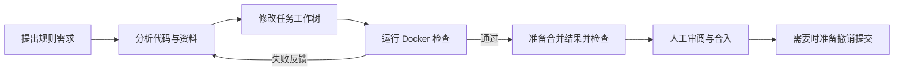

# 灰塔 — 面向游戏战斗逻辑的代码修复 Agent

开发者提出游戏规则问题，Agent 定位代码、修改独立工作区、运行测试，再根据失败结果继续修订。开发者审阅代码差异和检查结果，确认后合入；需要撤销时新增提交，保留修改历史。

**技术栈：** Python · LangGraph · LangChain · Git Worktree · SQLite · Docker · FastAPI · React / TypeScript

[使用指南](开始使用.md) · [Git 工作树与交付](Git工作树与交付说明.md) · [项目案例](https://herta27.top/posts/graytower-agent-case-study/) · [检索评测](research/evals/knowledge-rag-v1/README.md) · [个人博客](https://herta27.top/)

## 一项任务怎样完成

以“战技点收到负数时应报错，不能改变状态”为例：

1. Agent 搜索资源接口，阅读实现、调用位置和已有测试。
2. 在任务自己的 Git 分支和 Worktree 中修改代码。
3. 调用 Docker 检查，读取实际失败信息，必要时继续修改。
4. 准备与目标分支合并后的代码，再检查这份结果。
5. 开发者查看 Diff 和测试报告，确认后合入；撤销也经过检查和确认。



## 主要实现

| 模块 | 具体做了什么 | 源码 |
| --- | --- | --- |
| 后端接口 | FastAPI 与 Pydantic 定义任务、记忆和交付请求，校验参数并统一错误提示；`/docs` 提供可交互接口文档 | [web.py](src/agent_workbench/development/web.py)、[api_models.py](src/agent_workbench/development/api_models.py) |
| Agent 工作流 | LangGraph 编排单 Agent 的模型决策、工具执行和检查等待；需求有歧义时提问，保存进度后暂停，收到回答再继续 | [agent.py](src/agent_workbench/development/agent.py) |
| 模型与工具 | 通过 LangChain 接入 DeepSeek，校验工具参数，管理请求额度、超时和执行结果 | [model.py](src/agent_workbench/development/model.py)、[tools.py](src/agent_workbench/development/tools.py) |
| 状态与上下文 | SQLite 保存任务状态和执行记录；按需读取源码、裁剪过长结果，保留工具调用与返回结果的对应关系 | [context.py](src/agent_workbench/development/context.py) |
| 项目记忆 | 保存跨任务有用的约定与经验，附来源、适用版本和确认状态；支持查看、修改、删除，新任务检索已确认记录 | [memory.py](src/agent_workbench/development/memory.py) |
| 研发资料检索 | 文档按章节分块，使用 SQLite FTS5 / BM25 检索，返回正文、出处和版本 | [检索设计与评测](research/evals/knowledge-rag-v1/README.md) |
| 代码隔离与交付 | 每项任务独立分支与 Worktree；固定准备合入的提交，检查后再次核对版本，人工确认后快进合并 | [git_delivery.py](src/agent_workbench/development/git_delivery.py) |

Git Worktree 用来分开任务代码目录，Docker 用来限制检查运行环境。模型可以修改候选、发起检查，最终合入和撤销由开发者确认。

## 验证结果

| 验证内容 | 已完成的结果 |
| --- | --- |
| DeepSeek 编码任务 | 接入 DeepSeek API 修复负数战技点输入，通过 7 项专项检查与 99 项规则测试 |
| Git 与 Docker 交付 | 在临时游戏副本中走通检查失败、修订、检查通过、合入和撤销，保留提交与检查回执 |
| 工程回归基线 | Python 441 项通过、4 项既有跳过；前端 36 项通过，生产构建通过 |
| 资料检索 | 12 条本地查询中，11 条有相关资料，10 条首项命中；保留漏召回样例，便于继续改进 |

模型任务记录见 [编码任务与独立检查](research/evidence/completion-20261027.md)，Git / Docker 的脚本决策演示见 [工作树验收](research/evidence/git-worktree-20261028.md)。两类记录分别用于检查模型表现与工程流程，不混算任务成功率。

FastAPI 迁移及 8 项新增接口回归见 [接口验收记录](research/evidence/fastapi-migration-20261101.md)。

## 安装与运行

环境：Windows、Git、Python 3.11、Node.js 22.16+、Docker Desktop。完整游戏任务需要配套的 Python 游戏规则库。

```powershell
git clone https://github.com/theHerta27/graytower-agent.git
cd graytower-agent
.\安装研发助手环境.cmd
```

环境准备好后，双击 **打开灰塔研发助手.cmd**，打开 `http://127.0.0.1:18790/development`。配套规则库放在其他位置时，可以显式指定路径：

```powershell
$env:PYTHONPATH = 'src'
.\.venv\Scripts\python.exe -m agent_workbench.development serve --data local-data/development-workbench --project '你的游戏规则库目录' --port 18790 --open-browser
```

DeepSeek 密钥通过 `DEEPSEEK_API_KEY` 环境变量提供。浏览已有结果和运行本地检查不请求模型；页面确认发送材料与费用上限后才开始模型任务。详细步骤见 [开始使用](开始使用.md)。

## 运行测试

```powershell
$env:PYTHONPATH = 'src'
.\.venv\Scripts\python.exe -m unittest discover -s tests -v
cd frontend
npm test
npm run build
```

## 与 Herta Agent 的区别

[Herta Agent](https://github.com/theHerta27/herta-agent) 重点是自己实现编码助手的主循环、工具执行、人工审批和会话恢复。灰塔进一步面向游戏规则研发，重点处理任务代码隔离、游戏检查、项目记忆以及修改后的审阅、合入与撤销。两个项目独立维护。

`main` 是当前展示与使用入口。`research/` 和较早的设计文档保留实验、审计与开发过程，当前架构以本文和使用指南为准。
