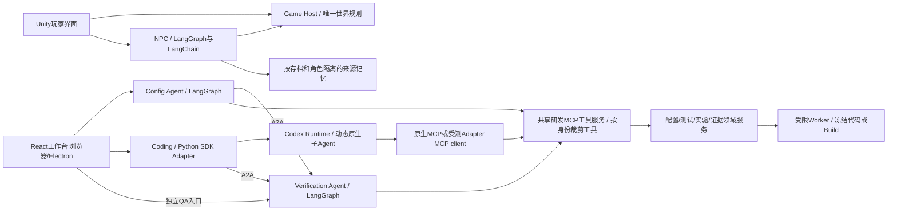

# 米哈游 Agent 项目群总体技术方案

**2026-10-05 M1 实施增量：** 新游戏仓库 `D:/Desktop/graytower-game` 已将 Bot 与玩家入口统一到 BattleSession；规则、RNG、阶段和事件只在 Python 结算，Host 的 SQLite 事务一起保存状态与命令收据。Unity 负责合法动作选择、提交、状态表现；请求先落盘，丢响应后按原 ID/原内容重试，收到旧收据仍重新读取最新状态。真实 HTTP 一局 85 命令及服务重启/全局重放通过；产品 EditMode、PlayMode、UTF Player 与构建已通过。Player 真实按钮、故障重试和跨进程恢复仍须独立现场证据，自动窗口采集超时不算游戏业务通过。详见[当前游戏入口](../graytower-game/README.md)。

**2026-10-05 Coding 实施增量：** 正式SDK/CLI0.160.0＋官方MCP＋DeepSeek namespace窄映射已完成真实文件业务：single/auto修改、原生Review、完整候选、同A2A独立QA。工作台接入持久运行/候选/报告，默认模型关闭；依然只支持numeric_config，M2代码/build及动态协作质量对照未完成。20次请求/4场；功能链完成但保留编辑重试及QA机制解释瑕疵，不宣称协作收益。[真实证据](research/evidence/coding-live-workbench-20261005.md)。

更新：2026-10-05。以本轮四能力产品边界为当前基线，替代旧三产品、Verification自行调候选和固定Coding协作profile的默认设计。本文是推荐架构；当前实现、研究探针和待验能力分别标明，整套产品尚未交付。

## 1. 推荐方案与业务价值

**2026-10-05 实施范围收敛（优先于后文生产目标）：** V1 只部署单机、本地服务、SQLite。现在实现候选身份、按完整 manifest 确认、请求幂等、Job receipt、图重入对账；未完成收据的作业明确保留未知，不静默重跑。多实例、HA、OAuth、公网 SSRF、多节点 lease/fencing 和生产级 outbox 只保留扩展边界。首个运行入口为 Config→A2A QA→MCP 游戏工具的 CLI 切片，React/Electron 在业务入口稳定后接入。每个阶段以完整可运行业务演示结束，接口、文档、测试数量不是里程碑替代品。

A2A SDK 队列问题已用官方固定版本 Hello World 独立复现并核对上游，见[最小案例报告](research/evidence/a2a-official-minimal-20261005.md)。当前不维护 fork、不修改安装包；产品完整请求新建 Task、终态只读，按公开准入接口拒绝续输入，不宣称上游资源缺陷已修复。必要的未来补丁必须最小、隔离、可替换。

**实施反馈：** 真实需求评测已发现“文案询问澄清但状态拒绝”、策略与版本混淆、只看日志开头就声称验证机制等问题。因此状态/工具参数的语义进入结构化Schema；每次决策读取当前额度；Trace改为可引用事件摘录并明确单版本边界。程序数值事实与模型调查解释分开验收，合法候选/完成报告不等于需求理解或机制解释正确。原失败和同题开发回归分别保存，详见[V1续验记录](research/evidence/v1-followup-20261005.md)。

**结构化决定的实施选择（2026-10-05）：** Config/Verification图每步需要一个决定，业务工具由程序执行。默认采用DeepSeek JSON Output，LangChain负责模型接入/消息与用量，项目适配层校验完整原文、恰好一个choice、正常终态及Pydantic结构。已实测默认工具解析只取首决定、JSON解析会修复截断，因此不直接信任宽松解析结果；不改框架、不引入provider回退。真实4次已知上下文协议回归和12题首次Config确认已完成；后者独立助手按24项冻结标准复核12/12通过，窄题逐项结果不外推总体成功率或QA全链。见[本轮结果](research/evidence/json-decisions-config-confirmation-20261005.md)。

建设一个可玩的“灰塔前哨”游戏和四个职责清楚的 Agent 能力：**Coding 实现变更，Config 生成策划配置，Verification 独立验证冻结候选，NPC 负责记忆与角色互动**。跨产品委托只有 Config→Verification、Coding→Verification，复用同一张 A2A Agent Card。Coding 内部保留 Codex 原生动态子 Agent，主 Agent 按任务判断是否委派、委派多少和做什么；不固定成 1＋3。

| 能力／使用者 | 真实业务问题 | 推荐与理由 | 可展示成果 |
|---|---|---|---|
| 游戏／玩家 | 亲手选择行动，看到数值与支援的实际效果 | Python唯一规则＋Unity6输入/表现，Bot/headless/真人共用BattleSession | 营地、战斗、结算、同源动作回放 |
| Coding／程序 | 跨规则、协议、Unity的改动难查全、测实 | Codex Runtime＋官方Python SDK＋业务Adapter，复用循环、上下文、Review和动态委派 | 候选diff、真实测试/评审、实际父子任务、可追溯交付；必要时委托独立QA |
| Config／战斗、数值策划 | 自然需求难准确落到合法配置 | LangGraph＋LangChain模型/工具/结构输出组件；程序检查schema/类型/引用/范围 | 字段解释、结构化候选、确定性诊断、可读diff、策划确认；可选行为验证 |
| Verification／QA及上游Author | 不知道某个确定变更是否实现目标、伤及其他行为 | 独立LangGraph Agent＋标准A2A＋游戏工具；自主计划、查证和调查，确定性Evaluator裁决 | PASS/FAIL/INCONCLUSIVE、失败复现、覆盖与限制、可读取证据；不修改候选 |
| NPC／玩家、策划调试 | 对话记得已知经历，并产生合法世界后果 | LangGraph＋LangChain组件，读记忆与事实、提出受控意图，Game Host执行 | 自然对话、支援选择、战斗效果、跨轮记忆和知情隔离 |

成品全部LLM推理使用DeepSeek，包括Review、规划、解释、辅助与格式修复；不隐式fallback。首个候选为实测过的`deepseek-flash`，任务记录provider、实际model、thinking、prompt/tools与预算。当前开发助手的模型不属于成品模型路由。

Python3.11.9、React/TypeScript共享浏览器/Electron页面、Starlette同源本地服务、SQLite领域账本与文件证据继续采用；当前没有为少量API再增加FastAPI层。四能力是业务边界，不强制四个仓库或四台服务：首版一个工作台仓库与一个游戏仓库，Verification作为独立进程/API可单独启动。Config/Coding/NPC模块分离，按安全与生命周期需要拆进程。工作台已纳入Git（当前实施基线4e2030d），与只读旧游戏源码分开追溯。

## 2. 审计结论、证据等级与复用

已读本目录JD/任务书/方案/路线/上下文、两个旧项目的README/current_context，并追踪实际运行模块、测试和Codex参考源码。详见本轮[Verification审计](research/evidence/verification-boundary-audit-20261005.md)、[Coding与Runtime审计](research/evidence/coding-runtime-boundary-audit-20261005.md)、[协议与框架审计](research/evidence/a2a-mcp-langgraph-audit-20261005.md)。不以包名或README历史成绩代替当前实现判断，也未逐文件通读Codex全仓库。

下表记录本轮架构审计**当时**的源码与缺口，后续实施进度以current_context及本节最新反馈为准。

| 审计时的源码事实 | 处置决定 | 审计时缺口 |
|---|---|---|
| 旧Verification根层含review→修复；v2可反复propose/simulate；旧prompt要求FAIL后修候选 | 需求、配置生成、diff迁Config；旧自动优化循环降为显式实验，不入默认QA | Config的独立模块、Schema查询与确认流程尚无产品实现 |
| 当前`combat_worker.py`仍在Verifier内部`apply_changes`；输入是changes而非上游完整候选 | 改为Author先物化冻结，Verifier只读并复检；完成receipt必须绑定预期候选hash | 当前src仍是可信numeric实验切片，本轮研究探针不冒充已完成该迁移 |
| schema/引用/规则/授权校验、模拟、Evaluator、配对报告、账本/checkpoint分离已有代码 | 保留为游戏适配与领域服务；Config预检、Verifier独立复检共用规则版本 | 跨revision预算、失败证据持久化、异步Job和不可信代码沙箱未完成 |
| 旧Herta有自己的模型工具循环，没有接入Codex | 迁移UI、工作区、流式/持久化经验；旧Loop/provider不迁为内核 | 正式Python SDK业务Adapter未实现，仅research受限工具/评审/协作实测 |
| 旧1主＋3子runner固定消息、角色和工具白名单 | 保留冻结benchmark源码/轨迹/评分；不复用其固定拓扑约束为产品 | 原生动态0..N、完整游戏工具、子权限/恢复尚待正式版本验收 |
| 无Config、A2A产品服务/card/client、NPC产品实现；游戏目前以模拟/Unity回放为主 | 新增业务模块和真实链路，不声称现有目录已交付四Agent | BattleSession真人输入、完整Unity自动链仍是硬门槛 |

不删除旧项目、失败记录或冻结实验；“淘汰”指新产品运行路径不再依赖旧修复循环、手写Coding Runtime和固定角色profile。迁移稳定且回归通过后，才删除新产品中的兼容支路。

| 判断等级 | 本轮例子 | 使用方式 |
|---|---|---|
| 官方／源码事实 | A2A SDK1.2.1支持协议1.0；MCP2.3.0改为MCPServer；本地SDK reader同步调用handler | 固定tag/本地内容hash及行号，不能外推未测版本 |
| 开源参考 | 官方A2A executor/routes/store/sample；MCP server/client；LangGraph持久化；Codex Runtime | 复用真实库与生命周期，不照搬demo鉴权、模型或内存存储 |
| 本项目设计决策 | 一个Verifier能力、两个Author客户端；不可变候选；预算/工作作业独立账本 | 写成待实现契约、接受故障与业务验收 |
| 尚待验证假设 | 动态委派在真实大型调查上的质量收益、独立QA的缺陷检出、语义召回价值 | 独立任务、合理基线和真实成本评测，不作为现有成绩 |

JD对应更直接：Config展示“策划配置生成”；Coding展示代码理解、工具、Review与研发提效；Verification展示独立规划、自动测试、证据与恢复；NPC展示Memory/RAG/多轮和可控游戏后果。A2A与MCP用来解决真实接入边界，框架节点数量不是Agent数量。未提供字节具体JD，不虚构逐条匹配。历史181项游戏Python、16项纯C#、旧Coding测试等仅按[验证报告](VALIDATION_REPORT.md)日期引用。

## 3. 游戏规则与产品用语

玩家管理三名队员，选择普攻、战技和终结技，对抗三阶段守卫。普通开局满生命、共享战技点3/5、各人能量0/120；普攻回复1战技点，战技消耗1点。终结技只能在该角色普通行动前选择，之后仍可普通行动。不能宣传尚不存在的任意插队终结技。

| 用语 | 真实含义与展示要求 |
|---|---|
| 行动值AV | 虚拟战斗时间，不是现实秒数，也不是行动次数。完整行动距离10000，速度100约每100 AV行动，Boss速度95约每105.26 AV行动。玩家主要看行动顺序；研发页显示AV并提供解释 |
| 通关速度 | 固定场景、Bot策略、seed且两版本均获胜时，逐对计算候选AV／基线AV；同时列原始值、共同胜利数及胜负转换。失败结束更早不算通关更快；游戏动画时长另测 |
| 胜率 | 指定配置、初始资源、Bot和seed集内胜利比例；超时留在分母并单列。不是玩家总体胜率；守卫死亡立即胜利，不要求清空召唤物 |
| 阶段机制 | 第一阶段火/雷弱点、韧性300；HP≤70%进入第二阶段，物理/雷、360、召唤；HP≤35%进入第三阶段，火/雷、420、蓄力。切阶段恢复韧性、重置动作和狂暴，不回血 |
| 蓄力与打断 | 第三阶段先蓄力、下次Boss行动释放；在此前击破可取消。第三阶段免疫控制但不免疫击破打断。现有玩家技能没有控制效果，不宣传已有眩晕玩法 |
| 机制保护 | 固定局面与行动脚本验证实际进入阶段、召唤、蓄力和打断；`phase_changed.entered=false`不算真正进入。随机样本不要求每局都触发所有事件 |

每阶段Boss第9次及后续普通回合增加狂暴；每层攻击增益分别10%／15%／20%。balanced在最低队友生命低于70%时倾向治疗；survival阈值85%，更保守使用战技点。它们是两种确定性策略，不是“普通玩家／高手”的实证代理。

新`BattleSession`仅在明确的输入边界保存；快照包括完整RNG状态、行动阶段和待处理规则状态。seed不足以恢复任意中途，RNG调用计数也不是状态。Unity以command ID、expected revision发送意图，Game Host判合法、结算并返回事件和新revision。客户端不复制伤害、资格或持续期算法。

## 4. 总体架构、标准协议与候选身份

不存在Config↔Coding的业务通信链。工具服务可供三个研发Agent使用，但鉴权、工具集合和输入权限不同；内部确定性节点可直接调用同一领域库。NPC不复用研发工具权限，不进入作者/验证迭代。

| 决策 | 推荐及解决的问题 | 边界或复议条件 |
|---|---|---|
| D01/D02规则与玩家端 | Python唯一规则；Unity6000.3.19f1表现/输入 | 不双写C#结算；完整Player自动输入与回收最终必过 |
| D03编排 | Config、Verification分别自定义LangGraph；NPC图＋LangChain组件；Coding由Codex运行 | 模型做理解/动态判断，workflow约束暂停/分支，tool做确定性执行；不一个节点一个Agent |
| D04Coding | 官方App Server/Python SDK，优先选当前稳定配对后锁定 | 不重写循环/压缩/子调度；本地参考SDK的默认accept/reader阻塞先回归，修复已上游则直接复用 |
| D05界面 | React/TS页面复用，Electron只管理sidecar与窄宿主bridge | Unity负责玩家，工作台负责研发；不复制三套页面 |
| D06状态 | 独立领域账本、图checkpoint、A2A TaskStore、文件artifact | 本机SQLite起步，不能因都用SQLite假设跨库原子事务或多实例调度 |
| D07检索/Skills | 词法＋结构关系/SQL实体过滤、带来源上下文；长专业方法按需加载 | 没有召回收益证据先不建向量服务；程序承担权限/规则 |
| D08工具 | MCP2新研发工具面＋内部领域端口 | MCP不是QA Agent，不提供沙箱/预算/幂等；旧MCP1.26证据不能算MCP2兼容 |
| D09执行 | 类型化候选、受限Broker与冻结执行环境 | 可信numeric可先交付；不可信代码/Unity必须通过独立执行边界验收 |
| D10协作 | Coding默认允许原生动态委派，主Agent决定0..N；保留single显式基线 | 固定1＋3仅历史实验；原生动态功能需真实DeepSeek/权限/恢复验证，收益另评 |
| D11模型 | 全部DeepSeek，无隐式辅助provider | 记录真实用量和服务alias，不声称固定权重；按协议矩阵解决兼容 |
| D12独立QA通信 | 一张Verification Agent Card、一套A2A1.0 JSONRPC/HTTP(SSE)接口 | 两Author复用同一client库与业务schema；不造私有REST冒充A2A，不先建注册中心 |

**版本结论（截至2026-10-05）：** A2A规范v1.0.1对应wire `1.0`，Python SDK1.2.1；MCP Python2.3.0；LangGraph1.2.12/checkpoint4.2.0/SQLite3.1.1。新协议依赖在独立环境共装且`pip check`通过，见[协议锁](research/probes/protocol-requirements-20261005.lock.txt)。A2A复用官方`create_agent_card_routes/create_jsonrpc_routes`、默认V2 handler、executor/updater和TaskStore。1.0使用Protobuf/ProtoJSON及`SendMessage/GetTask/CancelTask/SubscribeToTask`，不照搬0.3格式。MCP2用`MCPServer`、独立`httpx2`，旧`FastMCP`桥不原地升级。MCP2.3没有可用的Tasks运行实现；长模拟/Unity任务采用业务job提交/查询/取消/receipt工具，不能混为A2A Task。[官方A2A SDK](https://github.com/a2aproject/a2a-python/tree/v1.2.1)、[MCP迁移说明](https://github.com/modelcontextprotocol/python-sdk/blob/v2.3.0/docs/migration.md)

本轮真实协议probe的37项功能断言通过，但A2A1.2.1终态任务再输入拒绝路径留下队列清理告警，正式服务生命周期门槛未过。继续复用官方SDK，G0要求上游修复或受测最小补丁，不能把“稳定发布”直接写成生产可用。[实测与限制](VALIDATION_REPORT.md)

### 不复制整仓库的候选与证据契约

| Candidate类型 | 冻结内容与隔离 | Verifier运行方式 |
|---|---|---|
| Config | 固定规则包/依赖、完整Baseline/Candidate Config、scenario与schema版本；overlay须绑定不可变base并可物化、hash核验 | 同一可信模拟器分别加载两份配置；不需要复制游戏工程 |
| Code/Change | repo身份、base commit、candidate commit或base＋patch/dirty快照hash、工具链/锁文件；不能只有可变branch名/path | Git受限worktree＋缓存；未跟踪依赖也须入manifest。P4将来可用depot/revision/changelist/workspace映射，目前未实现 |
| Build | baseline/candidate构建artifact内容hash、目标平台、引擎/规则/配置清单 | 运行两份冻结build，受限输出目录；不在QA进程导入候选代码 |

`CandidateManifest`由Author冻结，含kind、author_run、parent revision、规则/环境身份、baseline/candidate/scenario引用及byte hash；编辑意图和批准独立记录。`VerificationRequest`含业务request ID、候选manifest引用/摘要、Change Intent、必需检查/声明范围和服务端验证的budget grant引用。不要传任意绝对路径/URL让服务抓取；artifact registry将允许的ID映射到受控存储，校验访问范围、大小、类型、hash及路径边界，外部URL需allowlist和SSRF防护。Agent间不传全仓库/全日志；按需分页读取特定trace或代码片段。

`VerificationReport`绑定上述身份、验证计划/版本、每项check的预期/观察/状态、逻辑样本与物理attempt、工具/环境、证据引用、限制和总体verdict。完整trace/日志作为按需artifact；只有hash没有可读取文件不算可复核证据。Config候选确认、实验预算批准、最终采纳/发布是三种不同决定。A2A Task ID、业务verification run、LangGraph thread、job、世界action不能互相代替。

A2A Agent Card只声明当前真正支持的kind/profile；首版支持Config，代码/build支持实现后再发布。使用标准Part承载版本化领域JSON不等于另造传输协议。鉴权来自可信HTTP会话，body中的author/tenant/context不是权限证明；卡是发现信息而非授权。协议状态`COMPLETED`代表报告已交付，可以携带业务FAIL或INCONCLUSIVE；执行器故障未交付才是`FAILED`。详细状态、取消/断线和恢复见[框架设计](FRAMEWORK_ORCHESTRATION_DESIGN.md)。

## 5. Coding：从自然需求到有证据的改动

程序遇到的问题：“NPC可以让玩家选开局护盾，但游戏还没有这个入口。请做出来，旧战斗别受影响，游戏里也要能看见。”

Agent先检查Scenario、护盾规则、Unity消费者和测试，确认护盾人数、数值、持续期、来源及覆盖行为。产品给出可审查的说明：下一战每人120点、各自第3个普通回合结束到期，耗尽提前消失；这是新功能设计值，仍需规则和体验验证。随后在独立工作区实现、执行测试、进行评审并交付diff。没有把工程工单要求预塞进玩家或程序的第一句话。

### 三层职责

| 层 | 实际做什么 | 我们增加什么 |
|---|---|---|
| Codex Runtime／Rust App Server | 会话、turn、模型循环、上下文组织/压缩、内置工具、流式事件、取消、rollout、MCP/Skills、原生Review与子Agent能力 | 默认复用；研究调用链与失败语义，不另造主循环 |
| 官方Python SDK | 启动/连接App Server、类型和RPC封装、事件分发 | 选择与CLI匹配版本；当前源码需核对人工审批路由、默认accept和reader阻塞问题，必要时最小补丁 |
| 项目业务Adapter | 将用户任务变成游戏研发交付 | worktree与基线、工具profile、游戏上下文、审批UI、事件持久化与重连、测试收据、Review结果核验、成本与恢复 |

原生Review可以通过同一任务的专门review阶段完成；无需另建长期Reviewer Agent。评审仍是产品必需能力：绑定冻结候选、范围、结构化findings或明确空结果及完成状态；程序核对文件/行号/证据。模型Review不能代替隐藏测试，也不能单凭“patch correct”宣告通过。高风险diff可比较原生独立Review上下文，但不预设强制拓扑。

原生子Agent的生成、独立上下文、消息、等待与关闭由Runtime负责。产品保留动态0..N委派：主Agent根据任务调查需要决定角色与数量；任务开始可选`auto`或`single`，前者允许动态协作，后者显式禁用子Agent供基线/简单任务使用。没有强制三个方向。业务Adapter提供可信角色/工具范围、总预算和证据投影，不把模型请求的model/sandbox参数直接当授权。首版目标是主Agent唯一写者、子Agent只读，但这是待验执行约束：须分别验证子shell、apply_patch、MCP与dynamicTools无法写主树；角色名或提示词不算隔离。若锁定Runtime无法对child降权，使用经验证的只读执行能力或隔离工作区，不能默认继承可写父权限后声称只读。需要并行写时使用独立工作区并串行集成。

本地源码显示普通fresh spawn不继承父thread的SDK dynamicTools，fork/history可恢复声明，但实际call路由/权限仍需测试；不能据父Agent工具可用推断子Agent也可用。官方当前文档支持的角色配置不一定被旧参考树投影。验证委托默认由主Author执行，子任务按范围提供证据。SDK回调在reader内同步运行时不能等待长QA任务；A2A client先持久化请求、快速提交返回task/run引用，之后由事件投影和查询续接，必要时最小SDK异步派发补丁。[本轮源码审计](research/evidence/coding-runtime-boundary-audit-20261005.md)

2026-10-04已经真实DeepSeek验证受限V1窄namespace/function映射的spawn/wait/close与固定1＋3轨迹；send、取消/恢复、完整改码及动态任务仍待验。当前官方稳定CLI为0.160.0，已测的是0.159.0-alpha.12.1，参考SDK默认CLI为0.153.4，三者不能混报。下一阶段选择可追溯稳定CLI/官方SDK配对，重验必要协议；不因升级文档便宣称兼容。[官方版本](https://github.com/openai/codex/releases/tag/rust-v0.160.0)

Coding可以先做自己的快速测试和Review，需要独立行为QA时才经同一A2A客户端委托Verification。报告FAIL返回本任务，Coding决定是否创建新Candidate Change；原验证对象和报告不变。turn完成、Review完成、QA报告交付、用户集成是不同状态。

### 2026-10-04接入证据与尚缺什么

已用真实CLI0.159.0-alpha.12.1＋参考官方Python SDK，完成DeepSeek原生`/responses`的只读function工具往返，以及原生inline Review的简单案例：3请求均HTTP200，输入7513、输出159 token（输出包含50 reasoning token），缓存命中1792。全部请求模型为deepseek-flash，未切换供应商。[原始记录](research/evidence/runtime-deepseek-20261004-152744/live-result.json)

该smoke使用独占审计relay加输出封顶、工具白名单，并缓存校验SSE后转发；**没有做Chat→Responses协议转换，但也不是未经改动的生产全工具测试**。没有验证真实shell、apply_patch、MCP、复杂Review、子Agent、实时流式延迟。新增本地捕获还发现原生MCP同样发namespace，属于主线接入待解决问题，见[MCP声明证据](research/evidence/runtime-deepseek-20261004-153025/result.json)。源码SDK默认CLI依赖0.153.4，与所测alpha不同，仍需固定配对版本及契约回归。不能据此把G0标全部完成。

DeepSeek已经提供原生Responses，因此先直接接入，不先建设通用协议网关。官方支持范围包括function和名为apply_patch的custom工具，其他工具/参数有差异，developer消息处理也与OpenAI不同；所有关键约束须程序执行。下一步按真实Runtime工具矩阵验证，再决定必要的窄调整。[DeepSeek Responses说明](https://api-docs.deepseek.com/guides/responses_api/)

### 执行、审批与恢复

人工审批模式显式使用`on-request`＋`approvalsReviewer=user`，默认auto_review不冒充用户批准。审批绑定request/thread/turn、进程generation、参数和工作区；拒绝、取消、超时和断连后拒绝迟到决定。读取线程不能被等待UI阻塞。自动安全审批若需模型，也必须走被验证的DeepSeek路由；未验证前采用用户审批或确定性禁止策略。

上游thread/turn/item与产品任务状态分别记录。事件持久化后派生UI，delta不能按文本内容去重；完成事件还要读status，turn结束不等于测试成功。恢复先读上游rollout，再核对工作区与Job receipt；未知命令不自动重放。取消模型、停止准入、实际进程退出分别显示。

首版重点贡献为：SDK审批/事件适配、游戏工作区和验证Broker、上下文检索、有效证据与交付对账。源码讲解要从用户任务沿context→模型流→工具路由/审批→执行→observation→结束走通，并解释取消和恢复为何仍需业务账本。[Codex源码定位](research/codex-source-audit.md)

## 6. Config作者与独立Verification：从需求到可核验结果

### 6.1 Config：让策划需求准确落到配置

策划说：“击破手的战技感觉偏弱，第二阶段有点拖。能不能调得顺一点，别把守卫机制改没了？”Config查询当前角色、倍率、相关机制和可修改字段，说明“拖”可能指行动值长，也可能是资源卡手；必要时追问。它可以给一个有理由的候选，例如倍率1.4→1.7，但必须标明这是待验证建议，不能承诺通关一定更快。

程序工具从固定baseline物化候选，检查schema、类型、引用、范围和依赖；生成“改了哪项、由多少到多少、可能影响什么”的diff，先冻结包含baseline/candidate/scenario、规则/schema版本和diff来源的完整Manifest，再让策划确认该manifest hash。确认只新增决定记录，不再改确认对象。模型可以修正不合法JSON/字段等生成错误，受调用上限约束；这不是根据模拟效果自动搜索最优数值。用户只要求明确字段变更时，不强迫其提供统计目标或跑实验。

若策划选择“验证实际表现”，Config通过A2A提交已确认候选、原始意图和允许验证范围；不把原始模糊意图擅自改成5%/2pp目标。Verification澄清检查范围或给描述性计划，验证预算另行批准。返回退化证据后，Config解释哪一局出了问题，策划可保留、放弃或要求修订；新版本另有候选ID/hash和验证请求，继续共用总授权预算。没有“FAIL就自动调到PASS”的默认边。

### 6.2 Verification：调查一个确定的变更

QA或程序会说：“这是新增战前护盾的候选版本，请检查持续期、断线恢复和旧战斗是否受影响。”QA Agent读取冻结manifest、变更意图、适用规则与已有测试回执，提出验证计划。先检查输入身份与能力范围，再选择规则测试、固定战斗脚本、配对模拟、特定trace或Unity检查。看到失败时可读取相关事件、比较两版本、追加预算内的诊断；它不会修代码、改倍率或重新生成Candidate。

Agent负责理解目标、动态选工具与调查反馈；workflow负责澄清/批准/等待/收尾；tool负责校验、模拟、测试、hash、统计和权限。证据足够后确定性规则汇总报告：必需标准全部满足且覆盖完整才PASS；已证违反必需标准则FAIL（即使其他覆盖未完也要标出）；已接收的任务缺证据、预算不足、所需检查暂不可用或仅描述性样本而无可判标准则INCONCLUSIVE。准入前不支持的candidate kind/profile、非法引用或语法/权限错误直接REJECTED或标准协议输入错误，不冒充已完成候选质量判断。模型解释不能覆盖Evaluator结论。

独立Verification页面接受人选择的现有冻结候选，Config/Coding都不在线也可用。它的可复用层是需求/计划、授权、任务/作业账本、证据与报告；游戏适配层定义规则、配置schema、执行入口、指标和检查Oracle。当前先适配combat-foundation，不为证明通用性再造游戏；只有真实第二适配完成后再宣称该范围的复用能力。

当前`src/agent_workbench/verification`仅是2026-10-04可信数值实验基线：LangGraph批准/执行、领域收据、配对描述性报告。16项原测试、12场正常和4场receipt-before-checkpoint恢复可复用，但worker仍生成候选、缺失败证据和上游候选hash绑定，必须按新输入重构。当前没有真实QA模型循环、A2A产品、完整Trace诊断、异步Job、跨revision预算或代码沙箱。不能把本轮协议fixture和冻结输入probe合称已交付独立QA Agent。

### 实际校准改变了哪些判断

2026-10-04的212场真实探索（32场压力选择＋180场对照，55.26秒）及20项原规则测试通过。所有配置变化在内存；Boss攻击490是QA压力条件，普通值175，不包装成已有难度。以下每格10对seed，都是探索，不是封存确认。[数据及源码指纹](research/evidence/game-semantics-calibration-20261004.json)

| 候选与场景 | 观察 | 产品应该怎么解释 |
|---|---|---|
| 倍率1.4→1.7，普通balanced／survival | 共同胜利AV比变化中位数−4.35%／−1.19%，双方均10/10胜 | 对这组Bot样本有改善，不能预设各策略都改善5% |
| 同候选，开局0 SP | −4.65%／−0.28% | 资源条件改变收益，不能只用普通满生命场景 |
| 同候选，高压balanced | 3/10胜→7/10胜；5败→胜、1胜→败；仅2共同胜利、AV变化+3.71% | 总胜率更高也可能出现具体退化；先展示那一局及可复现证据 |
| 第二阶段韧性360→288，普通survival | 整场AV+1.20%、第二阶段耗时+8.50%；蓄力打断5/10→0/10 | “韧性更低一定更快”不成立，不能只凭数值方向提建议 |

下一步以独立seed和人工体验验证“什么变化值得发布”，再冻结统计标准。不得用本轮结果倒推一个刚好通过的阈值。

### 严格统计与预算结论

撤销默认“改善5%、胜率下降不超过2pp、六cell×10000对”的业务要求及整批314160场执行计划。保留此前精确统计计算作为条件性设计参考，**不自动执行、不把历史预算视为用户授权**。

现有证据表明：普通Bot胜率饱和、压力条件有较多胜负转换，统一效应假设不成立。首版交付硬规则/机制检查＋配对描述性报告。只有明确要求发布级概率声明时，才根据业务容忍度、独立pilot的胜负不一致率、共同胜利比例、成本上限和可接受不确定性预注册严格实验。

以前的数学结论仍有效：六cell/12单侧界下，50对且零胜负不一致，保守非劣下界约−10.38pp，不能证明−2pp；至少272对只适用于零不一致特例。10000对/cell的高功效来自假定q=.1、真实差0，并不适用于所有配置；接近容忍界仍很难证明。AV的500共同胜利对、273达标门槛也依赖事先约定5%目标及统计family，不能凭空变成产品需求。[完整核算](research/verification-statistical-budget-20261004.md)

确认集不回流调参；不看结果追加到PASS；基础设施失败重试同seed，不增加统计n。逻辑样本与物理attempt/CPU/存储/模型费用分账，预算耗尽如实不完整或INCONCLUSIVE。具体新路线见[实施路线8.3](IMPLEMENTATION_ROADMAP.md)。

## 7. NPC：角色知道什么、玩家选什么、世界做什么

玩家刚经历开局连续受伤，回营问军需员岚能否帮忙。岚负责实在、关心人的支援；侦察员砾说话简短，侧重已经解锁的观察线索。差异来自角色指令与可知资料，不靠重复口头禅。NPC可以换讲法、追问和选择合法意图，不能编造新弱点、奖励数值或任务完成事实。

LangGraph负责可见上下文→只读检索/工具→结构化意图→验证→玩家确认→提交或查收据→记忆投影→最终回复。LangChain负责DeepSeek接口、`@tool`与只读ToolNode、Pydantic输出；世界写入单独节点处理。schema合法不代表有权限，模型只选内容包中允许的行动，Game Host检查资格、存档revision和规则。

### 完整玩家交互示例

以下是**待实现内容与体验目标**，不是录制的成品对话。支援每次出战二选一：战技补给开局+1点、默认3→4、满5时不提供；开局护盾每人120点，持续至该角色第3个普通回合结束，耗尽提前消失。120用于缓冲普通Boss初段单击；尚未验证平衡，不承诺能挡住后期蓄力。现有辅助终结技是324点/2回合，和这项新支援不同。

> 玩家：上次刚开打就掉了好多血，后面一直忙着救人。  
> 岚：那我帮你把开局垫稳一点。这次能带一份支援：多一点战技补给，或者给每个人备一层护盾。  
> 玩家：有什么区别？  
> 岚：补给让你们开场从3点战技点变成4点，谁需要谁用。护盾是每人120点，挡完就没了，没用完也会在那个人第三个回合结束时消失。它主要帮你们稳住开局，到了蓄力阶段还是得留意打断。  
> 玩家：那就护盾吧。  
> 〔玩家确认；程序记录下一战支援并返回成功结果〕  
> 岚：备好了，下一战每人都有一层。这次就带这份。等守卫开始蓄力，还是要盯住它的韧性，及时打空才能拦住那一下。  
> 玩家：再给我一份补给？  
> 岚：这次已经备好护盾了，只能带一种。先把这场打完，回来再准备下一次的。

玩家进入战斗，看见三人生命条旁各有120护盾及剩余回合。一次实际命中后，UI依据权威事件减少护盾；例如无其他修正时，普通Boss对主攻手单击结算103点，可吸收103、余17。后续击中耗尽则图标消失，否则在该角色第三个普通回合结束移除。重新连接回读实际余量，不再发一份。这个具体初始案例仍须新功能测试验证，不能把算例当Player实测。

如果执行响应丢失，岚只能说“我还没确认是否备好，先查一下”，恢复按原action ID取收据，再宣布成功。若岚没有收到战报，只能回应“你刚才说开局掉血很快”，不能声称自己看过那场战斗。角色台词不展示方案ID、资格校验、receipt等内部词。

### 知情、记忆与恢复

玩家、存档、分支和NPC的scope由可信会话绑定，不接受模型自行指定。先按当前可见投影、内容兼容版本与有效期过滤，再检索；旧经历不因世界revision变化就被简单等值过滤掉。保存亲见、被告知、世界事实的区别与来源event IDs；摘要是可重建缓存。两NPC未分享的秘密不能串入，玩家自述不自动升级为任务完成事实。研发实验报告不进入角色人生记忆。

世界state＋command receipt＋outbox同事务；NPC inbox＋来源记忆同事务。稳定action ID在执行前保存，同ID同payload先查原receipt，再检查新命令revision；同ID换参数拒绝。另设每次出战支援资格唯一键，阻止两个新ID重复奖励。最终回复也有持久message ID，避免重连重复显示。图checkpoint不能回滚奖励；超时/取消也不撤销已提交世界结果。完整故障点见[框架设计](FRAMEWORK_ORCHESTRATION_DESIGN.md)。

## 8. 指令、Skills、检索和MCP的边界

### 指令放在哪里

| 位置 | 适合的内容 | 本项目决定 |
|---|---|---|
| 稳定基础指令 | 角色职责、何时澄清、不得无证据宣告结果、可知范围约束 | 四能力各自短而稳定；模型遵循只是辅助，权限仍由程序检查 |
| 当前任务上下文 | 当前需求、版本、授权范围、可见事实、检索证据、实验摘要 | 按任务/存档构造，有来源、有版本和长度预算 |
| 按需Skill | 较长、反复使用的专业方法、操作顺序、失败诊断参考 | Coding优先考虑“如何完成游戏变更验证”；先记录实际反复需要的内容，再写Skill，不预造一整套目录 |
| 工具/领域代码 | 数值合法性、统计计算、资格、执行、权限、幂等、预算 | 确定性执行，不能由Skill或系统提示词代替 |

旧Herta系统提示写在CodeContextBuilder；旧Verification加载game_change.md。旧运行链路未发现Skill发现/加载实现，因此不宣称已使用Skill。Coding复用Codex原生发现/按需读取能力，不造第二个loader；Config/Verification/NPC首版以版本化基础指令和节点上下文为主，长方法反复出现再接显式按需资源加载，且不得绕过工具权限。完整工具清单不等于每轮全部塞给模型。

### 四种业务检索与RAG

RAG是“确定需求与权限→取资料→排序/裁剪→带来源给模型→核对回答证据”的流程；词法、符号、结构、向量只是其中的检索方法。用了RAG不代表必须建向量数据库。

| 产品 | 查什么、怎么查 | 给模型什么／验证什么 |
|---|---|---|
| Coding | 当前commit/dirty hash内路径、符号、字段、调用/配置引用、测试与C#消费者；rg/BM25＋Python AST和配置引用边 | 有界代码片段、路径行号和为何关联；比较证据召回及实际任务成功，不把全文堆上下文当检索 |
| Config | 当前schema/catalog、字段/枚举/引用、baseline和相关规则；按版本/实体/字段精确查询，中文别名辅助 | 有界配置/规则片段及来源，生成后确定性校验；比较字段定位、合法候选与需求符合率，不以语义相似冒充合法 |
| Verification | 冻结配置、候选diff、授权、实验manifest、摘要和特定失败seed事件 | 先用SQL/ID/指标筛选，分页取证据和原始trace片段；来源hash可核验，不向量化整场trace。模型解释后claim指回样本 |
| NPC | 本存档中该角色可知的经历、已解锁知识、当前合法选项 | scope过滤在排序前；按实体/事件/时间/任务标签召回，摘要保留来源。真实中文记忆集证明不足后再比语义或混合检索 |

2026-10-04的6条固定查询、相同6000字符/8片段预算：第一轮强词法与加catalog别名均必要证据宏召回61.11%，完整2/6；别名没有显示增益。针对失败补自动配置字段/值→AST访问和分支的关系索引，在同一扩展语料下词法66.67%／完整3/6，结构扩展83.33%／完整5/6。“奶妈大招罩子”仍未命中。这是看过缺口后的探索改进，不是保留集或代码任务成功率；首版采用小范围可解释结构关系，随后独立标注集验收，不立即上向量服务。[初轮证据](research/evidence/retrieval-probe-20261004.json)、[同语料结构对照](research/evidence/retrieval-structure-probe-20261004.json)

FTS5实测默认unicode61不能把中文整句当任意双字子串检索，trigram也不能解决两字查询；不能把“使用SQLite FTS”当作中文检索已经可用。NPC目前仅有合成scope负例，不是完整记忆检索效果验收。

### MCP接入关系

应用宿主负责模型会话与可信用户上下文；MCP client负责协议连接、列举/调用；MCP工具服务检查身份、scope、schema、预算并调用领域实现。三个研发Agent复用一套有版本的工具实现，按身份裁剪可见工具：Config可读schema/config并在自己的候选区生成/校验；Coding可查契约、执行受限测试；Verification只读冻结候选、提交获批检查并读证据，没有候选写工具。即使模型猜出隐藏工具名，服务器也必须拒绝越权。

首版新服务用MCP2.3.0。Verification/Config的模型工具调用通过MCP适配，纯程序节点可直接用领域接口；本机单宿主可用stdio，服务需多宿主共享时采用单独验收的Streamable HTTP。工具服务可以分进程启动但指向同一领域实现/账本，不要求所有Agent共用一条会话。长作业只快速返回job ID，查询/取消也只处理控制和收据，不把整场验证塞成`verify_everything()`。

Coding优先验证当前稳定Runtime原生MCP＋DeepSeek，若namespace仍不兼容，沿已验证设计采用SDK dynamicTools→Adapter MCP client窄转接。旧MCP1.26桥仅离线fixture通过，不能称MCP2或完整真模型链已验。此桥是Agent→工具，不是实现原生子Agent，也不是替代A2A的巨型验证工具。Coding内的A2A提交/查询回调是标准协议客户端的模型入口，背后仍是独立Verifier服务。

NPC采用服务端scope注入的角色工具/领域接口，查询可见世界和记忆、提交有限世界意图；不暴露研发shell、全仓库和未公开知识。MCP不提供业务授权、沙箱、幂等或自动可靠性；这些由服务端领域与Broker实施。[MCP官方架构](https://modelcontextprotocol.io/docs/learn/architecture)

## 9. 动态原生协作与跨产品QA委托分别验收

Coding的**产品能力**是主Agent按目标决定0..N原生子任务，支持上下文隔离、独立调查、并行和专业化；由Codex管理生命周期。角色是允许范围与指令模板，不是每次必建的固定团队。单Agent入口保留，框架不在每次任务前强制拆解。Config/Verification先各自一个有工具的自主Agent，NPC也保持一个；无需求就不增专业Agent。Config/Coding→独立Verification属于跨产品能力复用，不是给Coding内部硬塞一个常驻Reviewer。

产品开始时`auto`表示允许原生动态协作，`single`显式只用主Agent；UI记录实际是否创建子任务、目标/权限、结果证据和全部成本，不能将“允许协作但本题0子”标成实际团队执行。首版不做运行中切换。动态角色可用性、取消/恢复、父子工具权限和DeepSeek全路由先过门槛，再提供正式入口；这项工程交付不以历史固定profile取得质量优势为前置。

2026-10-04固定1主＋3子是封闭资料评审benchmark：16次开发＋28次确认，single/A+/parallel均14/14已知根因、0误报，完整证据9/14、10/14、8/14；未证该profile值得推荐。四个同分工串并配对Runtime墙钟少46.9%，不是全产品端到端提速或优于single。保留[冻结原始报告](research/evidence/collaboration-evaluation-20261004.md)，不删负面结果，也不将它外推为动态原生协作无价值。

下一轮在真实仓库调查、跨规则/Unity失败日志任务验证动态分工。合理single、资源增强single、动态auto使用相同完整工具/检索和冻结验收，分别回答：增加投入换来多少质量；相当额外资源下是否仍有价值；有真实独立并行时缩短多少总时间。若要归因调度，对开发冻结的相同分工另做串/并对照，不能强制正式auto固定三人。预先固定独立确认任务和预算，报告误报/漏报、证据、真实验收、父子总token/费用、端到端时间、协调失败和维护成本；不给普遍成功保证。收益成立的任务可以明确推荐动态协作，收益不稳定就保留可用能力、限定适用说明，不宣传未证增益。跨产品独立QA也须验证有用缺陷发现和交付成本，不因使用A2A就声称质量更高。

参考Anthropic的任务拆分/独立上下文经验，但不搬文章数字或固定拓扑。[Building effective agents](https://www.anthropic.com/engineering/building-effective-agents)、[Multi-agent research system](https://www.anthropic.com/engineering/multi-agent-research-system)。实施与对照见[路线4.1与8.5](IMPLEMENTATION_ROADMAP.md)。

## 10. 用户入口、页面与桌面集成

2026-10-05 V1 落地选择：先交付 React 浏览器页面，由现有 Python 环境中的 Starlette 提供同源静态文件与本地 API，不增加第二个业务后端。HTTP 只适配候选确认、Config 图和 A2A 独立 QA；`workbench.sqlite` 保存页面操作状态，候选、验证请求、Job receipt 和图 checkpoint 仍各归原领域所有。轮询满足本机进度读取，暂不引入消息平台。默认禁用模型，显式启动额度可限制为 QA-only；Electron 主进程接入留到浏览器链稳定后。当前已有结果的页面演示与新真实模型验收分别记证据。

| 使用者 | 入口与页面 | 操作到成果 |
|---|---|---|
| 程序 | 工作台Coding：仓库、任务、进展/审批、diff、测试、评审 | 选基线→说需求→确认边界→看修改与测试→评审→导出/显式集成 |
| 策划 | Config：需求、配置/规则、候选diff、确认与验证报告 | 说需求→澄清→合法候选→确认；可选委托QA→看证据→由Author修订新候选或交人工采纳 |
| QA／程序／策划 | 独立Verification：选择冻结候选、意图、计划/预算、任务、证据报告 | 检查确定变更→调查失败→返回PASS/FAIL/INCONCLUSIVE；不在此编辑候选 |
| 策划调试NPC | 工作台NPC调试：测试存档、角色可知事实、检索来源、行动、记忆、延迟 | 在分支存档对话→查看为何可选/被拒→核对世界与来源；不展示私有思维链 |
| 玩家 | Unity营地、对话、支援选择、战斗HUD、结算 | 交谈→了解效果→确认→战斗看见效果→回营延续；不接触研发日志 |

浏览器开发直接连接loopback API；Electron主进程管理sidecar、随机端口、会话token、目录选择及退出，renderer继续使用同一React API/事件层，host bridge提供差异能力。Electron启用contextIsolation、renderer无Node执行权，preload仅暴露窄接口。打开Unity Player独立窗口；不在Electron内硬嵌游戏，也不要求玩家打开研发工作台。Unity只持短会话凭据，模型密钥留服务进程。

任务时间线显示上游工具或图节点、可核实结果和引用；内部ID、原始参数、授权与费用放可展开调试区。主报告先讲“改了什么、有什么帮助、哪些样本变差、还缺什么”，统计定义和工程字段随后展开。

## 11. 执行安全、Unity最终交付与演示

开发候选代码只能在被验收的受限工作区执行。MCP子进程不自动继承Codex shell沙箱；当前可信numeric worker也不算沙箱。Broker计划复用独立、无模型凭据App Server的`command/exec`，固定配置cwd/argv/env/profile。源码WindowsRestrictedToken分支不支持stream/write/terminate，自定义输出cap也受限；必须实测buffered硬超时与进程树回收。断开连接不会保证作业停止，不能用移除隔离来解决Unity兼容。

Unity完整自动链路为最终硬门槛：冻结候选→Python/契约→真实Editor EditMode/PlayMode→UTF Windows Player tests→普通产品Player构建→真实OS键鼠进入UI/EventSystem→Game Host结果与typed UI状态对照→清理和封存。代表跨端任务和最终release必须完整执行，日常可用较小profile。

`-runTests`不搭`-quit`；交互产品Player不带`-batchmode/-nographics`。退出码、当次XML、必要测试清单、日志和产物hash共同判定；全skip、零测试、旧XML、失焦输入、残留进程均不能过。G0-U未通过，M2完整闭环与M5保持未完成，不能以手测或16项纯C#代替。[完整Unity合同](research/unity-automation-delivery-20261004.md)

最终演示按业务顺序：程序新增战前支援→Coding交付候选并委托独立QA→策划用Config生成数值候选、确认后委托同一QA并展示退化/不确定结果→操作者发布固定release→玩家与岚交谈选择支援并实际战斗→回营延续经历，再切存档证明隔离。插入一次实验恢复和一次NPC丢响应对账。演示模型离线时仍可玩，预写台词标识降级，不冒充在线Agent。

不建设任意游戏平台，不先建向量数据库，不承诺P4/UE/Maya真实接入，不为展示而重写Rust。下一阶段先做Config冻结候选→独立Verification→证据回Author的最小真实业务链；并行推进M1可玩会话、G0稳定Runtime动态协作和真实Unity门槛。详见[实施路线](IMPLEMENTATION_ROADMAP.md)与[当前状态](current_context.md)。
