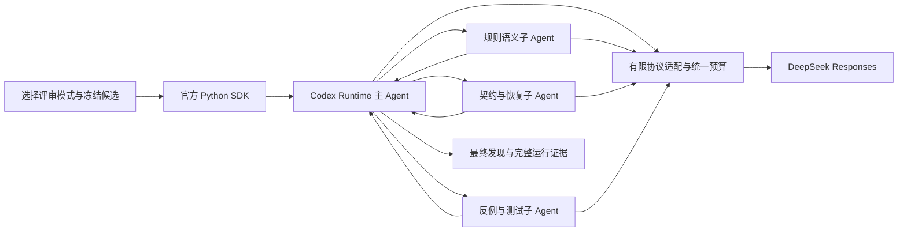

# 真实 Coding 协作对照

日期：2026-10-04。已完成16次开发对照、28次独立确认及盲判。结论：真实1主＋3子协作已实现；相同分工的并行运行更快，但本轮未显示可重复的质量提升。保留单Agent作为产品基线，四种实验运行方式可复用，暂不将本套封闭资料评审profile升级为默认或推荐的正式协作模式。开发过程中委派子任务不计为成品多Agent证据。

## 场景、实现与对照

游戏程序准备合并一组优化：减少快照分配、调整护盾展示，或改善实验恢复、SSE 清理。代码能运行还不够，评审要发现会改变规则、污染历史状态、重复执行实验或漏发终止事件的问题，并给出准确位置、触发条件和修正办法。

本轮选择 Coding 的跨文件候选评审。方案是一个主 Agent 和三个原生子 Agent：规则语义、契约与状态恢复、测试反例。子 Agent 独立调查，主 Agent 核对证据、去重和剔除误报。三个方向是本次评审 profile，不是三个产品必须沿用的角色数量。

| 条件 | 实际执行方式 | 回答的问题 |
| --- | --- | --- |
| single | 一个 Agent 一次完整调查，自行覆盖全部三个方向 | 正常可用基线 |
| single_plus | 同一 Agent、同一 thread；确认阶段六轮：完整审查→规则→契约/恢复→反例→证据复核→汇总；全部计费 | 额外推理本身能否取得同样收益 |
| team_parallel | 主 Agent 先原生创建三个子任务，汇总前等待全部完成 | 分工与额外投入后的质量和代价 |
| team_serial | 同样三个方向，前一子任务完成后再创建下一子任务 | 在相同分工下检验并行时间收益 |

所有条件都获得相同的完整冻结材料，包含普通中文需求、业务规则、候选 diff、带原始行号的相关源码。单 Agent 的基础指令同样覆盖三个方向，没有故意只给它一部分资料。模型可以判断问题、构造反例和给修正建议；本轮没有向模型开放 shell、文件写入或游戏执行工具。因此这证明的是有限材料下的候选评审效果，不能外推为完整仓库开发或 Unity 交付效果。

这里的single是“完整冻结资料、无执行工具的单次评审基线”，不是完整Coding产品基线。六份材料每份约1.5—2.3万字符，已被程序预选并能放入上下文；本轮主要考察独立专业复核，没有充分施加海量检索/日志造成的上下文压力，也没有验证不同工具权限互相干扰时的分工价值。真实源码上的注入候选有明确真值，但不等于自然产生的真实线上缺陷分布。后续仓库探索、改码和工具验证必须另评，不能把本轮结论推广到所有多Agent工作。

父子模型统一为 DeepSeek Flash。运行使用本机 Codex CLI `0.159.0-alpha.12.1`、本地官方 Python SDK 源码及 V1 子 Agent 生命周期。Runtime 负责创建、独立上下文、等待、结果回传与关闭；项目适配层只做有限 namespace/function 名称转换、工具白名单、预算和证据记录，没有重新编写 Agent 主循环。子 Agent 的完整公共材料在每次真实请求前核验，私有真值不发给模型。



SDK 是程序调用 Runtime 的入口；原生工具负责实际子任务生命周期。MCP 游戏工具和 LangGraph 都没有被拿来代替这一调度层。本轮对模型开放的工具只有限定的原生生命周期工具。Runtime 自动注入的项目 AGENTS 和基础 Skill 说明对各条件相同，原始请求留存；不声称发送给模型的总 token 仅来自公共 packet。

项目新增工程集中在[受限运行器](../probes/collaboration_live_runner.py)、[业务分工profile](../probes/collaboration_profile_runner.py)、[批次与失败记账](../probes/collaboration_batch.py)和独立评测工具。正式接入仍需要维护上游工具schema、SSE事件对应、取消/恢复及预算账本；这不是只添加三段角色提示。一次合法wait参数被本地guard误拒、开发串行消息可能转述早先结论，都是本轮实际发现并修正的工程成本。没有可靠的人时记录，不虚构维护工时或金额。

## 任务与判定

[公开任务索引](../evals/coding-collaboration/tasks/public/manifest.json)包含两道开发题、四道确认题。确认题含一道无注入缺陷的候选，用于检查误报。候选以真实源码构造；13 个注入根因明确属于评测修改，不声称是旧项目原有缺陷。

[真值核验](../evals/coding-collaboration/oracle/private/verification.json)执行了 14 项检查：13 个注入问题和一个干净对照。Python、SQLite、asyncio 检查使用冻结函数；C# 展示问题使用源码检查和数值反例，未启动 Unity。确认任务在任何质量输出前封存；真值穷举仅限明确的候选改动范围。

[评分器](../evals/coding-collaboration/evaluate.py)生成去掉模式、重复次序、状态、费用的输出包，由另一开发 Agent 对照源码逐条核验根因、触发条件、位置和证据。它不是人类评审，也不是参试模型自评。文本风格可能泄漏分组，不能声称完全盲化。标题关键词不自动得分；重复问题不增加召回率；真值外的有效新发现单列，不修改冻结分母。

报告同时保留分配任务数、实际启动数、未启动数、失败、截断和可评分完成数。重复运行用来观察稳定性，不能当成新的独立任务。证据是否足够、严重漏报和干净候选误报，与正确问题数量分开记录。小样本只给描述性结论。

开发集为两题×两次×四条件，共16次。确认前另冻结四题×两次×三个主要条件，以及两题×两次串行配对，共28次。原先拟三次重复，依开发用量在任何确认调用前改成两次，为既定100万输出总限额保留尾部和失败余量；四道确认题全部保留。具体顺序、资源和停止规则见[确认 manifest](collaboration-confirmation-manifest-20261004-fixed-v1.json)，不根据确认结果换题、改提示或补跑某一方。

确认阶段每次模型请求最多32,768输出token、每项任务最多360秒；single总上限32,768输出token，A+与团队均为131,072。A+最多6次模型请求；团队最多24次，包含原生调度与汇总。根据开发集团队平均费用与四轮A+费用比约1.48，将确认A+增加到六个有明确目的的阶段。相同总输出上限不等于实际资源完全匹配；输出长度、重复输入、缓存、调度请求均报告实际值，不能声称严格同token或同费用的因果实验。

开发阶段主Agent自行撰写分工消息；串行消息可能包含前一子任务已提出的缺陷假设。因此开发串并耗时只作运行观察。确认改为三个事前固定的通用专业任务，通过工具schema枚举和精确参数校验执行；串并角色消息、公共资料、模型和汇总要求相同。独立审计检查真实子thread、初始上下文、重叠区间，以及每个子任务确实返回completed结果后才关闭并进入主Agent最终汇总。

[资料覆盖审计](../evals/coding-collaboration/oracle/private/evidence-coverage-audit.json)发现20项证据要求中18项完整、1项部分覆盖、1项缺少指定源码片段。所有根因仍可判断；缺失的调用链是各模式共同限制。严格提交证据分数保留，但不奖励猜出未展示源码，也不把共同缺项包装为组织优劣。

## 预算、计时和工程校准

本轮所有 smoke、父子调用、增强单 Agent 复查及失败共用同一账本，累计费用保守上限 3 美元、600 请求、1,000,000 输出 token；未知结果保留预留额度。每项真实请求在外发前登记，不因新建批次而重置预算。用户已明确授权将六份冻结评测包和模型分析发送至 DeepSeek 官方 Responses 接口。

账本以峰价预留；本轮周日实耗按非高峰用量估算。Flash 非高峰每百万 token：缓存未命中输入 0.15 美元、命中输入 0.003 美元、输出 0.6 美元。估价不是账户账单。[DeepSeek 官方价格](https://api-docs.deepseek.com/quick_start/pricing/?tab=case-studies)

费用表计入参试DeepSeek全部父子请求和同thread复核。辅助开发、编写任务与盲判所用Codex会话没有可独立核算的费用数据，未计入这些模型费用表；不能把表内估价称为整项研发总成本。请求返回名为`deepseek-flash`，未固定服务侧模型权重；模型版本变化需重新验证。

付费批次之间串行运行，团队内部由 Runtime 并行；本地测试和独立评判可能同时运行，没有隔离机器负载。表中时间是一次Runtime执行的墙钟时间：包括启动、全部模型与原生工具等待、主Agent汇总和client/server清理；起点在目录/packet写入之后，终点在最终wire/events/result保存、profile审计、batch规范化与独立评分之前。历史字段名为`end_to_end_seconds`，本报告称“运行耗时”，不把它包装成完整产品从请求到核验交付的端到端SLA。

子活动区间来自实际 SDK 事件；只有同分工串行与并行均遵从，才计算本轮观察到的运行时间差。串行后续任务是否夹带前一子结果另查实际spawn消息，不能仅凭`fork_context=false`推断。确认只有两道独立题、各两次串并配对；第一轮并行在串行之前，第二轮次序反转，未固定模型采样随机种子，也未消除服务排队、缓存与生成长度变化。可报告这四对的全部时间差，不能据此声称普遍加速比例或纯调度因果效应。

所有工程校准都保留在[运行记录索引](collaboration-engineering-attempts-20261004.json)：

- 真实原生单子 Agent 接入 smoke：5 次请求全部 200，18.843 秒，输入 26,015、输出 2,976 token；只证明接入，原始误报保留。
- 第一份业务包被网络沙箱阻止；随后自动审批要求具体外发授权。取得用户明确授权后才继续，没有绕过拒绝。
- 4,000 输出上限的一次请求全部消耗在推理，收到 `response.incomplete/max_output_tokens`。校准后统一提高单请求上限至 16,384；这次截断不叫协议失败或单 Agent 漏报。
- 三子 Agent 运行暴露适配器对原生合法 `wait(120000)` 的错误拒绝。校验改为原生 10,000—3,600,000 毫秒范围，整项任务仍受独立 wall deadline 限制；新增回归并重放原始失败响应通过。[修订证据](collaboration-live-runner-20261004-v2/README.md)
- 开发正式比较中一次增强单Agent请求在16,384输出上限全部用于推理，未交付最终结果。该失败留在16次分母，不用前一轮答案替代。确认前将所有条件的单请求上限统一提高到32,768。
- 三个固定专业方向的真实接入smoke完成9请求、40.469秒；同线程六阶段的结构另用真实Runtime与本地fixture验证。它们属于工程校准，不计入独立确认质量样本。

正式比较采用修正后的同一 runner；旧校准、失败和未启动记录不删除。失败时尚有在途请求的用量可能不完整，报告未知及预算预留，不把缺少 usage 当成零费用。

## 开发结果

[开发评分与逐项结果](collaboration-development-final/summary.json)来自两批独立封存的盲判，合并只替换盲ID与真实run ID的对应关系，不改判定。四个条件各4项任务重复；每次含3个已知根因。

| 条件 | 完成交付 | 正确根因 / 误报 | 完整提交证据 | 平均估价 USD/次 | 运行耗时中位数 |
| --- | --- | --- | --- | --- | --- |
| single | 4/4 | 12 / 0 | 10/12 | 0.002216 | 17.27秒 |
| single_plus（四轮） | 3/4 | 9 / 0 | 6/9 | 0.010369 | 75.07秒 |
| team_parallel | 4/4 | 12 / 0 | 8/12 | 0.015351 | 59.61秒 |
| team_serial | 4/4 | 12 / 0 | 10/12 | 0.016263 | 119.47秒 |

耗时和费用包含失败那次；正确根因及提交证据只统计已交付结果。A+一次16,384输出截断没有最终交付，因此全体交付缺失3个根因，不把它记为模型作出了三个错误判断。所有完成结果均找全已知根因，普通单Agent达到本套开发题的检出上限，未显示协作检出增益。

“根因正确”不等于每句说明都准确。例如一份输出把浅复制的影响扩展到重新赋值的顶层标量，另一份把实验账本的覆盖写误说成重复累加；它们不增加独立误报根因，但降低提交证据完整性。共同缺少的`fresh_turn`创建片段另标资料限制。开发只涉及两道题，不能据此否定更复杂任务的价值；因此继续使用先前封存的四道确认题验证，而非更换成已知会使单Agent失败的题。

## 确认结果与采纳

28项全部完成，无截断/基础设施失败；独立评分完成、无未决发现。确认集中共有7个独立注入根因和1个干净候选；表内14或8次根因命中包含重复运行，不能称为14或8个独立问题。[完整评分](collaboration-confirmation-final/run-scores.json)、[汇总](collaboration-confirmation-final/summary.json)、[四批盲判合并来源](collaboration-confirmation-final/merge-provenance.json)

| 条件 | 交付 | 已知根因命中 | 误报 / 漏报 | 完整提交证据 | 干净候选正确 |
| --- | --- | --- | --- | --- | --- |
| single | 8/8 | 14/14 | 0 / 0 | 9/14 | 2/2 |
| single_plus，六阶段 | 8/8 | 14/14 | 0 / 0 | 10/14 | 2/2 |
| team_parallel，1主＋3子 | 8/8 | 14/14 | 0 / 0 | 8/14 | 2/2 |
| team_serial，仅两题配对 | 4/4 | 8/8 | 0 / 0 | 4/8 | 未分配 |

**额外投入没有换来更多已知问题检出或更高交付率。** 团队相对普通single的根因命中差为0，提交证据完整项反而少1。对照六阶段A+时根因命中仍相同，团队完整证据少2；当前没有证据支持协作独有的质量增益。此处“完整证据”是严格逐条判定，含公开材料缺口这个共同限制，不作为总体能力百分比。

不同模式都出现了根因正确但支持性论断不准的情况。一个例子是把一次Boss蓄力取消说成之后永久不轮换，省略每次都被取消的条件；另一例把“直接取消等待者”混同于已被管理器保护的普通断线取消路径。并行团队第二次SSE评审还给出可能重复扣减队列字节账本的修复建议。这些不另算新的误报根因，但会影响修复可靠性，所以没有把14/14包装为完美业务质量。[最后一批盲判笔记](collaboration-confirmation-scoring-part4/review/adjudication-notes.json)

逐题结果也没有呈现稳定优势：在行动窗口/Boss题，团队第一轮证据好于single，第二轮反而更差；SSE题第二轮团队证据不如single和A+。各组完整发现了本套候选问题，存在明显检出上限；四道独立题不足以证明各架构等价，更不足以否定更复杂仓库探索中的协作价值。

[最终原生审计](collaboration-confirmation-native-audit-20261004.json)确认28/28轨迹合规：201次DeepSeek请求全部HTTP200且正常终止；36个原生子Agent在真正completed后关闭，父最终汇总随后开始。8个parallel均有真实重叠，4个serial固定消息不传前子答案；8个A+均同一thread完成六阶段、无子Agent。这已解决本轮受限业务的真实接入问题，不能再将其称为“只跑了fixture”。

### 实际投入和运行时间

以下三种主要条件都覆盖同样四题、每题两次；费用与时间均为8次平均值。[完整测量数据](collaboration-confirmation-final/measurements.json)保留每对资源、缓存与时间。

| 条件 | 输入token总计 | 输出token总计 | 平均估价USD/次 | 平均运行耗时 |
| --- | ---: | ---: | ---: | ---: |
| single | 58,928 | 28,744 | 0.002689 | 20.33秒 |
| single_plus，六阶段 | 463,912 | 165,542 | 0.013740 | 103.94秒 |
| team_parallel，1主＋3子 | 864,132 | 112,714 | 0.011134 | 42.25秒 |

相对普通single，团队平均费用约4.14倍、运行时间约2.08倍。相对六阶段A+，团队平均费用低约19%、运行时间少约59%，但输入token更多、输出更少、缓存不同。这说明这套协作比固定六阶段复查用时更短，不说明它在严格同token投入下更有组织优势，也不说明优于所有可能的单Agent增强策略。

同样三个专业方向的串并配对如下；只比较预先指定的两题和各自重复，不拿serial两题与parallel四题的总体均值比较。

| 任务/重复 | 串行秒 | 并行秒 | 减少秒 | 减少比例 | 串行/并行估价USD |
| --- | ---: | ---: | ---: | ---: | --- |
| 行动窗口/Boss机制，1 | 74.875 | 42.625 | 32.250 | 43.1% | 0.010931 / 0.014665 |
| SSE唤醒/取消所有权，1 | 162.703 | 77.641 | 85.062 | 52.3% | 0.022556 / 0.021037 |
| 行动窗口/Boss机制，2 | 77.813 | 36.844 | 40.969 | 52.7% | 0.010593 / 0.009639 |
| SSE唤醒/取消所有权，2 | 118.266 | 73.218 | 45.048 | 38.1% | 0.015659 / 0.017944 |

四对均更快；平均每对少50.83秒，合计433.657→230.328秒，减少46.9%。这是本轮**相同分工下观察到的运行耗时改善**。并行不是每对都更便宜，四对总估价反而比串行高约5.9%；原生请求数、生成长度及缓存不同，不能把全部差值归因为纯调度。它没有比普通single更快；完整UI/工具验证/交付端到端时间仍未测。

这四对的根因检出相同，但证据质量并非完全等价：串行完整证据4/8，并行在同一子集为2/8，差异集中在第二次SSE运行。因此46.9%不代表“保持全部质量不变的加速”。六阶段A+平均慢于团队，也不能单凭这一点说明需要采用协作：普通single在当前任务已更快、更省，检出相同。

### 总账本

本轮协作研究共登记352次模型请求额度，其中350次有完整用量，另2次旧失败保留未知用量额度。已知输入4,413,928、输出666,150token，按非高峰价估算USD0.487120；未知请求另留峰价USD0.048152与20,384输出token预留。整个账本按峰价计已知实耗＋未知预留为USD1.022392，输出实际＋预留686,534，均在USD3/600请求/100万输出限制内。[结束时账本快照](collaboration-confirmation-final/global-budget-snapshot.json)

其中确认28项201次请求估价USD0.280251。上述研究总额包含开发、确认、工程smoke及已知失败消耗；没有丢弃失败费用，也没有把未知费用写成0。它仍是用量估价，不是账户账单。

### 本轮决定与后续实施

保留已经实际运行的四种模式和可审计的原生协作实现，但**本套封闭资料评审不进入默认或推荐的正式协作路径**。原因是额外费用没有换来稳定质量提升；普通single的已知问题检出、交付已达本套上限，团队证据准确性也未优于基线。此决定针对当前任务、模型与profile，不是“多Agent无用”，也不是因为其不够便宜或接入未完成。

不额外建设一个没有已证收益的工作台协作推荐入口；目前本机研究CLI可在开始时选择四种模式，README列出用法。已做的协议适配、预算、轨迹和评测代码可复用于下一轮。正式产品仍推进完整单Agent工具与上下文基线，G0-C、BattleSession、Unity自动链、Verification需求/证据闭环继续按路线实施。

下一类值得检验的业务是**完整仓库的跨层变更调查及失败日志定位**：需要动态找文件、跑确定性工具、面对大量无关中间结果，才能实际检验上下文保护和工具专业化。在真实工具接入后，以工具/检索/摘要完整的single及更灵活的同Agent复核对照；使用未参与本轮设计的新任务并先验证公共资料覆盖。不要继续挑选当前题或更换seed直到出现正面结论。若出现可重复业务收益，再按M2-C4交付任务开始可选、父子状态/证据/总费用及取消恢复的正式模式；无需预设永远三个子Agent。

尚未验证：V2 agent_message、send、生产取消/重启恢复、限流和未知在途请求对账、仓库改码/执行工具、Unity与最终功能交付。这些工程范围不被本次28个成功评审替代；Verification和NPC没有因本次Coding结果被强制改成多Agent。

### 复核入口

[54项测试记录](collaboration-tests-20261004.json)包括22项运行/预算/profile、16项评分器、16项既有Verification回归；另有14项冻结真值程序检查。一次Verification测试命令漏设`PYTHONPATH=src`，在发现测试前失败；按README补上后16项通过。没有改业务源码掩盖环境问题。

[方法复核](../evals/coding-collaboration/scoring-records/confirmation-method-review.json)与[计量复核](../evals/coding-collaboration/scoring-records/final-measurement-review.json)分别检查资源/计时边界及454项数值断言。454是证据算术核对，不是454项产品测试。下面只重算已有封存结果，不调用模型：

```powershell
Set-Location -LiteralPath 'D:\Desktop\mihoyo-agent-project'
& .\research\.venv-framework\Scripts\python.exe -B research/evals/coding-collaboration/evaluate.py score --results research/evidence/collaboration-confirmation-final/runs.json --oracle research/evals/coding-collaboration/oracle/private --adjudications research/evidence/collaboration-confirmation-final/adjudications.json --out local-data/collaboration-score-replay
& .\research\.venv-framework\Scripts\python.exe -B research/probes/check_documents.py
```

原始输出、旧失败、各阶段runner快照、冻结清单和盲判seal均保留；重算验证因果判定与输出摘要绑定，不会自动改判。真实重跑既有题只作演示，不能当新确认样本或重新解释已封存的独立性。

[最终报告独立复核](../evals/coding-collaboration/scoring-records/final-report-review.json)确认质量数字、配对子集、原生审计和采纳判断与原始证据一致，无实质一致性问题。已用当前评分器原样重算最终结果并逐对象比较一致，没有新增模型调用。
